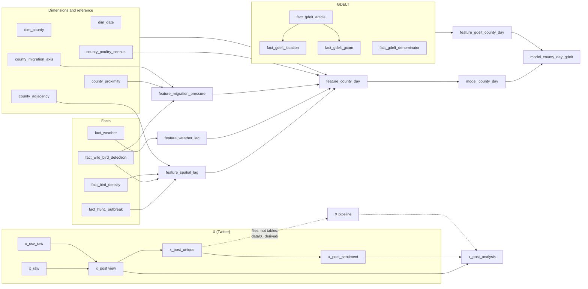

# Database tables: what is in the `h5n1` database

*Nick, 2026-10-17. Measured read-only against Cloud SQL (`h5n1`, schema `public`). Row counts are
exact `count(*)` on that date. Connection instructions are in `docs/DB_ACCESS.md`.*

The database has 31 relations: 26 tables, 4 materialized views and 1 view. They follow a
star schema at **county (5-digit 2021-vintage FIPS) × day**: shared `dim_*` dimensions,
one `fact_*` table per source, `feature_*` layers built from the facts, and frozen `model_*`
tables the models read. The X (Twitter) tables sit outside that grain, one row per post.

## At a glance

| Table | Kind | Rows | Size | Date range | What it is |
|---|---|---:|---:|---|---|
| **Dimensions and reference** | | | | | |
| `dim_county` | table | 3,143 | 0.7 MB | — | Every US county: state, name, centroid, population, land area |
| `dim_date` | table | 2,557 | 0.4 MB | 2020-01-01..2026-12-31 | Calendar: year, month, ISO week, season, holiday flag |
| `county_adjacency` | table | 18,566 | 1.8 MB | — | County pairs that share a border |
| `county_proximity` | table | 787,620 | 76 MB | — | County pairs within 400 km, with distance and bearing |
| `county_migration_axis` | table | 3,108 | 0.3 MB | — | Flyway and breeding/wintering bearings per county |
| `county_poultry_census` | table | 3,143 | 0.4 MB | census year 2022 | NASS poultry operations and inventory per county |
| **Facts (one per source)** | | | | | |
| `fact_h5n1_outbreak` | table | 2,090 | 0.6 MB | 2022-02-08..2026-07-13 | USDA/APHIS confirmed HPAI detections in domestic birds (**the outcome**) |
| `fact_wild_bird_detection` | table | 8,465 | 1.2 MB | 2021-12-30..2026-07-06 | USDA/APHIS HPAI detections in wild birds |
| `fact_weather` | table | 7,433,815 | 777 MB | 2020-01-01..2026-07-21 | NOAA daily min/max temperature and precipitation |
| `fact_bird_density` | table | 25,736 | 2.2 MB | 2020-01-01..2025-07-10 | USGS bird-banding counts, 9 high-risk waterfowl species |
| `fact_social_sentiment` | table | **0** | — | — | Planned county-day sentiment; never filled |
| `fact_egg_economics` | table | **0** | — | — | Planned laying-hen/egg data; never filled |
| `fact_x_post` | table | **0** | — | — | Empty orphan; no code in the repo writes it |
| **GDELT news** | | | | | |
| `fact_gdelt_article` | table | 169,953 | 71 MB | 2022-01-01..2026-07-21 | One row per avian-flu news article, with tone |
| `fact_gdelt_location` | table | 1,231,883 | 209 MB | — | Places mentioned in each article |
| `fact_gdelt_gcam` | table | 169,953 | 21 MB | — | Emotion word counts per article (anxiety, death, …) |
| `fact_gdelt_denominator` | table | 85,592 | 6.3 MB | 2022-01-01..2026-07-21 | All GDELT articles per state-day, for rates |
| **X (Twitter)** | | | | | |
| `x_raw` | table | 176,974 | 503 MB | — | Raw twitterapi.io JSON lines (English, Spanish, French) |
| `x_csv_raw` | table | 426,291 | 349 MB | 2022-06-01..2024-12-31 | The prior cohort's X CSV export, all columns as text |
| `x_post` | view | 603,265 | — | 2021-09-01..2026-10-16 | Both raw sources parsed into one shape; still has duplicates |
| `x_post_unique` | table | 540,225 | 801 MB | 2021-09-01..2026-10-16 | One row per post, de-duplicated (**the X corpus**) |
| `x_post_sentiment` | table | 540,225 | 168 MB | 2021-09-01..2026-10-16 | Waree's XLM-R sentiment score for each post |
| `x_post_analysis` | table | 603,265 | — | 2021-09-01..2026-10-16 | Every `x_post` row with location, sentiment, labels and funnel disposition (**what the X analysis reads**) |
| **Feature layers** | | | | | |
| `feature_migration_pressure` | table | 2,160,827 | 179 MB | 2021-12-31..2026-07-27 | Directional wild-bird infection pressure |
| `feature_spatial_lag` | matview | 3,421,313 | 649 MB | 2020-01-02..2026-12-31 | Trailing counts for the county and its neighbors |
| `feature_weather_lag` | matview | 7,433,815 | 823 MB | 2020-01-01..2026-07-21 | 7-day weather windows |
| `feature_county_day` | matview | 7,524,342 | 3.9 GB | 2020-01-01..2026-07-21 | Everything joined: the full modeling surface (76 columns) |
| `feature_gdelt_county_day` | matview | 7,524,342 | 915 MB | 2020-01-01..2026-07-21 | GDELT news features per county-day |
| **Modeling tables** | | | | | |
| `model_county_day` | table | 7,524,342 | 2.1 GB | 2020-01-01..2026-07-21 | Frozen snapshot: Waree's 23 RF predictors + target |
| `model_county_day_gdelt` | table | 7,524,342 | 2.5 GB | 2020-01-01..2026-07-21 | Same snapshot + 12 GDELT columns (35 predictors) |
| **Bookkeeping** | | | | | |
| `model_build_log` | table | 5 | — | — | One row per build of a `model_*` table |
| `schema_migrations` | table | 15 | — | — | Which `sql/0xx_*.sql` migrations have been applied |

## How the pieces connect

The X pipeline (`h5n1/sources/x_posts.py`, `x_topics.py`) reads `x_post_unique` and writes
parquet files under `data/X_derived/`. `h5n1/sources/x_analysis_table.py` brings the result
back into the database as `x_post_analysis`. `docs/x_data_funnel.md` follows the posts
through every step.

## Table by table

### Dimensions and reference

**`dim_county`** — 3,143 counties in 51 states (50 + DC). Columns: `fips`, `state`,
`county_name`, `centroid_lat`, `centroid_lon`, `population` (no NULLs), `land_area_sqmi`.
Every fact table keys to it on `fips`. **2021 vintage:** Connecticut uses its traditional
counties (09001–09015), not the 091xx planning regions APHIS doesn't report in. Loaded by
`h5n1/sources/census.py`; population backfilled by `sql/backfill_population.py`, which aborts
if it sees 091xx codes.

**`dim_date`** — one row per day, 2020-01-01 to 2026-12-31: `year`, `month`, `iso_week`,
`day_of_year`, `season`, `is_us_holiday`. Seeded by `sql/seed_dimensions.py`. Facts key to it
on `day`, so a source dated before 2020 fails the foreign key. That is why the bird-banding
loader clips to 2020.

**`county_adjacency`** — `(fips, neighbor_fips)` for counties that touch, including at a
single corner point; 18,566 pairs, about 5.9 neighbors per county. Five island or remote
counties in Hawaii and Alaska have none. Defines the "neighbor" in every `nbr_*` feature. From `h5n1/sources/census_adjacency.py`.

**`county_proximity`** — `(fips, neighbor_fips, distance_km, bearing_deg)` for the 3,108
contiguous-US counties, every pair within 400 km. Used by the migration-pressure feature, which
filters to 300 km at query time. From `h5n1/sources/migration.py`.

**`county_migration_axis`** — per county: `flyway` (Mississippi 1,241, Central 824, Atlantic
805, Pacific 238) and the compass bearings toward the breeding and wintering grounds. Feeds
`feature_migration_pressure`.

**`county_poultry_census`** — USDA NASS 2022 Census of Agriculture, one row per county:
operation counts and inventory for layers, broilers, turkeys and ducks, plus poultry sales.
**NULL means withheld, not zero:** 348 counties have layer operations but a NULL layer
inventory, because NASS suppresses it with `(D)`. Counties with withheld layer inventory behave
like mid-to-large layer counties, so never fill these with 0. From `h5n1/sources/nass_poultry.py`.

### Facts

**`fact_h5n1_outbreak`** — the outcome. One row per `(fips, day, flock_type)`, 2,090 rows,
all `confirmed_flag = true`. `flock_type` is APHIS's category: "WOAH Non-Poultry" (829 rows,
mostly backyard flocks), "Commercial Turkey Meat Bird" (448), "WOAH Poultry" (245),
"Commercial Table Egg Layer" (129; 152 million birds, the bulk of birds affected), and 19
smaller categories. `birds_affected` is the flock size. From `h5n1/sources/usda.py`.

**`fact_wild_bird_detection`** — APHIS wild-bird HPAI detections: `detection_count` and
`n_species` per county-day; 19,426 detections in 1,567 counties. It's the migrating source of
infection in the spatial and migration features. Also from `h5n1/sources/usda.py`.

**`fact_weather`** — NOAA daily `temp_min_c`, `temp_max_c`, `precip_mm` for 3,108
contiguous-US counties. The largest fact table (7.4 million rows). From `h5n1/sources/noaa.py`.

**`fact_bird_density`** — USGS bird-banding counts per county-day for 9 high-risk
waterfowl species (Mallard, Canada Goose, Wood Duck, teals, Northern Pintail, Lesser Snow
Goose, Common Tern); 533 counties. **The column `band_count_smoothed` is mislabelled:** it holds
the raw daily count, and smoothing happens in the feature layer. Ends 2025-07-10, the NABBP
release cutoff. Banding counts measure where banders work as much as where birds are. From
`h5n1/sources/usgs_bird_banding.py`.

**`fact_social_sentiment`, `fact_egg_economics`** — created by `sql/002_facts.sql` as
placeholders in the original design and **still empty**. `feature_county_day` left-joins
`fact_social_sentiment`, so its `post_count` and `sentiment_*` columns are NULL everywhere.
The X work took a different route (files, not this table), so nothing is expected to fill it.

**`fact_x_post`** — empty, and no code in the repo creates or reads it. It looks like an
early landing table from the X loader, which isn't in the repo. Safe to ignore; ask before
dropping.

### GDELT news

All four come from `h5n1/sources/gdelt.py` (migrations `013`–`015`); see the `gdelt-source`
memory for the full story. Both pre-registered GDELT tests (volume and emotion) came back null.

**`fact_gdelt_article`** — one row per avian-flu article in the GDELT Global Knowledge
Graph: `gkg_record_id`, `day`, `source_domain`, `url`, tone measures (`tone`, `tone_pos`,
`tone_neg`, `tone_polarity`), `word_count`, `themes`, and a `syndication_key` that groups
reprints of one story.

**`fact_gdelt_location`** — every place each article mentions: 1.23 million rows. `loc_type`
1 = country (345,878), 2 = US state (619,322), 3 = US city (266,683). Only city mentions carry
a county `fips`; state and country mentions don't. A state-level mention is geocoded to the
state's centroid, so never assign it to the county containing that point.

**`fact_gdelt_gcam`** — one row per article: GCAM word counts for anxiety, tentativeness,
death, uncertainty and negative affect, plus `gcam_wc` (words scored). The basis of the
pre-registered emotion test.

**`fact_gdelt_denominator`** — every GDELT article (not only avian ones) per state-day, for
52 state codes. It turns counts into per-10,000-article rates and controls for GDELT's
coverage changing over time.

### X (Twitter)

The loader for these tables isn't in the repo, and the search query strings weren't recorded.
See the `x-post-unique-provenance` memory.

**`x_raw`** — one JSON line per post returned by twitterapi.io, in column `line`. The keys
mark the stream: `_kw` (the Spanish keyword) means Spanish, `_tier` means French, `_g`
otherwise. The post itself is under `line->'t'`.

**`x_csv_raw`** — the prior cohort's CSV export, loaded as-is: 33 columns, all `text`
(numbers and dates not yet parsed). 426,291 rows covering 2022-06..2024-12. A post found by
several search terms appears once per term.

**`x_post`** (view) — parses both raw tables into one set of typed columns (`post_id`,
`created_at`, `lang`, `post_type` original/reply/quote, `post_text`, user fields, engagement
counts, `corpus`, `source_query`, and the original JSON in `raw`). It's a `UNION ALL`, so it
still has the duplicates: 603,265 rows = 426,291 + 176,974.

**`x_post_unique`** — **the X corpus.** One row per `post_id`, with `source_queries` (every
term that found it) and `times_matched`. 540,225 posts:

| `corpus` | Posts | Span | Note |
|---|---:|---|---|
| `prev_cohort_en` | 364,220 | 2022-06..2024-12 | Prior cohort's scraper; 99.9% English |
| `twitterapi_en` | 78,591 | 2021-09..2022-05, 2025-01..2026-09 | No posts in 2022-06..2024-12 |
| `twitterapi_es` | 76,631 | 2021-09..2026-09 | One collection process throughout |
| `twitterapi_fr` | 20,783 | 2021-09..2026-10 | Not used by the pipeline |

**The English source switches on 2025-01-01, the exact train/test split.** Any jump in X
features at the split is partly a change of collector. The author's bio is at
`raw->'author'->'profile_bio'->>'description'`.

**`x_post_sentiment`** — Waree's scores from `notebooks/Sentiment Pipeline.ipynb`, computed
on gpu1 on 2026-10-15. One row per post: `negative_score`, `neutral_score`, `positive_score`
(they sum to 1), `final_sentiment` (the most likely class) and `cleaned_post_text`. Model
`cardiffnlp/twitter-xlm-roberta-base-sentiment`. Caveats:
- **It's the project's sentiment score** (since 2026-10-19). The X pipeline reads it as
  `positive_score − negative_score` through `waree_sentiment()` in `h5n1/sources/x_posts.py`.
- **It covers every post in** `x_post_unique`. The 7,688 French posts added after it was built were scored on cuda1R on 2026-10-19 with the same method (300 already-scored control posts reproduced to 1e-6) and appended.
- The scores are mostly negative (63.6% overall), because the topic itself is negative.

**`x_post_analysis`** — **what the X analysis reads.** One row per `x_post` row, keyed by
`(corpus, post_id, source_query, row_seq)`; `row_seq` numbers rows that are identical even in
their search term. Built 2026-10-19 by `h5n1/sources/x_analysis_table.py` (`build`, then
`load`). Each row carries:
- the post and author fields from `x_post`, plus `stream` and `search_terms`;
- the geocoded location (`geo_level`, `state`, `county_fips`), the author's `account_type` and
  `hub_author`, and the copypasta flags;
- Waree's sentiment scores and `sentiment` (positive minus negative);
- the LLM labels (`local_obs`, `illness_seen`, `exclusion_reason`, `event_state`) and
  `sighting_week`;
- `disposition` and `disposition_step`: the first funnel step that removes the row, or
  "Sighting". The names match the step names in `docs/x_data_funnel.md` exactly;
- `use_sentiment` (the filtered subset) and `use_sightings` (disposition = Sighting).

### Feature layers

These sit between the facts and the models. **Refresh in this order:**
`feature_spatial_lag` → `feature_weather_lag` → `feature_county_day`, running
`SET LOCAL work_mem = '64MB'` first. All trailing windows are **past-only** (they end the day
before), except the 7-day weather window, which includes the current day because weather is
observed the same day and detections are not. Outcome columns start with `target_`.

**`feature_migration_pressure`** (table) — per county-day: `breeding_side_pressure` and
`wintering_side_pressure`. Each sums recent wild-bird detections within 300 km in the
direction birds arrive from, weighted by distance (`exp(-km/150)`) over the past 21 days.
Built by `h5n1/features/migration_pressure.py`.

**`feature_spatial_lag`** (matview) — per county-day: 7-, 21- and 60-day trailing counts of
the county's own outbreaks, wild-bird detections and banding counts, plus the same for its
bordering counties (`nbr_*`), and days since the last outbreak in the county and in a
neighbor. Only days with any activity nearby are stored (3.4 million rows), so missing rows
mean zero.

**`feature_weather_lag`** (matview) — per county-day: 7-day precipitation total, 7-day mean
minimum and maximum temperature, and how many of those 7 days had data.

**`feature_county_day`** (matview) — the full modeling surface: every county × every day
(7.5 million rows, 76 columns), joining the dimensions, the poultry census, the outcome, the
three feature layers and the empty social-sentiment table. Targets
`target_outbreak_next_7d` / `_14d` and their `target_complete_*` flags, which are false
where the future window runs past the data. **NULL means not observed, never zero**
(withheld poultry inventory, missing weather). The `model-county-day-table` and
`modeling-surface-conventions` memories have the details.

**`feature_gdelt_county_day`** (matview) — 12 GDELT columns per county-day: state article and
story counts and per-10,000 rates (7 and 21 days), state tone mean and negative share (21 days),
county counts from city mentions, and a national rate. NULL outside GDELT coverage.

### Modeling tables

**`model_county_day`** — the frozen table Waree's production random forest trains on. One row
per `(state, fips, day)`, the target plus 23 predictors selected by RF importance > 0.020
(`regression_baseline.ipynb` section 10.2). Counts are `log1p`-transformed and NULLs are
kept. It's a **snapshot**: it doesn't update when `feature_county_day` does. 12,587 positive
`target_outbreak_next_7d` rows. Rebuild with `sql/rebuild_model_county_day.py`; the current
version is `model_build_log` build 2 (2026-09-09).

**`model_county_day_gdelt`** — `model_county_day` build 2 plus 12 log-transformed GDELT columns
(35 predictors), for the GDELT lift test. Rebuild with
`sql/rebuild_model_county_day.py --variant gdelt`; current version is build 5 (2026-09-24).

### Bookkeeping

**`model_build_log`** — one row per rebuild of a `model_*` table: when, feature set, rows,
number of predictors, the last source day (2026-07-21 for all five builds), and notes.

**`schema_migrations`** — the 15 migrations in `sql/` (`001_dimensions.sql` through
`015_gdelt_gcam.sql`) and when each was applied. Written by `sql/run_migrations.py`.

## Things that will bite you

- **Modeling data ends 2026-07-21** (USDA outbreaks 2026-07-13), but X runs to 2026-10.
  Posts after the last outcome day plus 30 can't be scored against outcomes.
- **Every feature and model table depends on the facts**, so after reloading a fact table,
  refresh the matviews in order and rebuild the `model_*` snapshot. Otherwise the models keep
  reading the old data.
- **Three tables are empty** (`fact_social_sentiment`, `fact_egg_economics`, `fact_x_post`),
  so their columns in `feature_county_day` are NULL everywhere.
- **The database is shared with Max and Waree.** Read-only queries are fine. Ask before
  dropping, deleting or altering anything.
