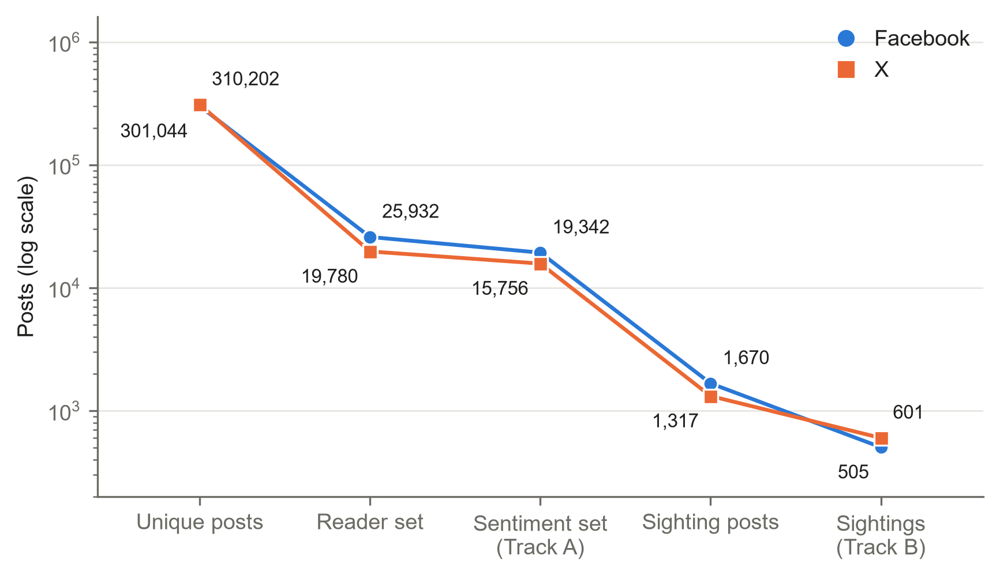
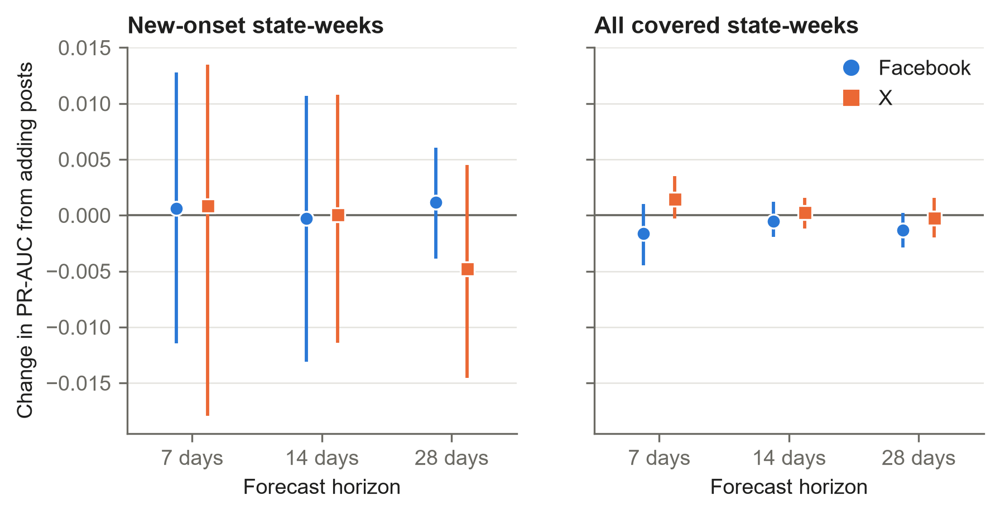
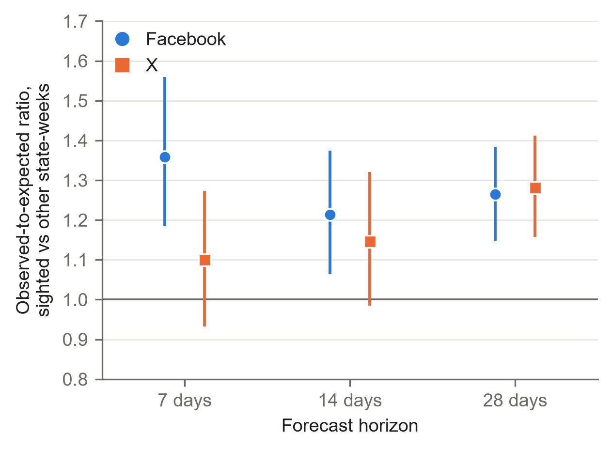
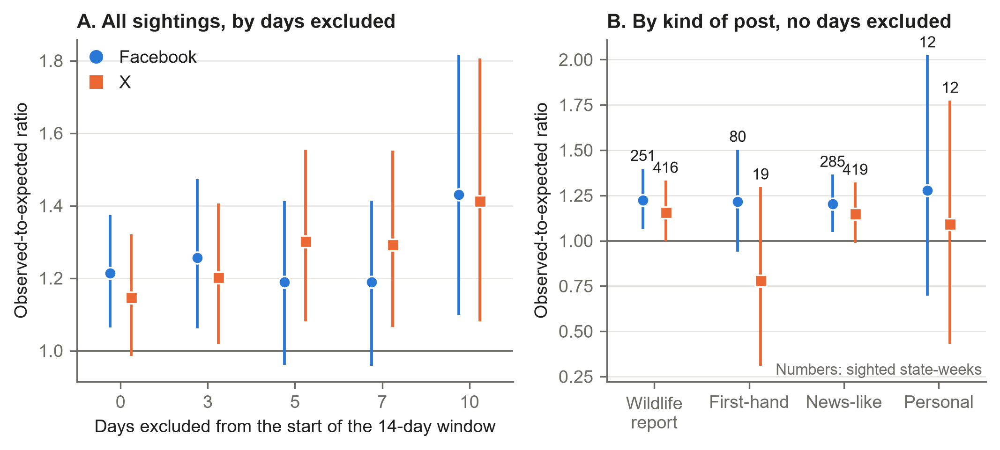

<!--
DRAFT 1, 2026-11-18; X numbers updated 2026-11-19 after the X re-pull and again the same day after the repair of its missing query-days. First full draft for JMIR Public Health and Surveillance. Source of the
.docx (build: see the end of this comment). Every number comes from the result files listed
in docs/journal_rebuild/PROGRESS.md.

OPEN ITEMS FOR NICK
1. IRB "not human subjects research" determination: not yet obtained. The Ethical
   Considerations paragraph is a placeholder.
2. Meta Content Library publication terms: confirm that results derived from the UI export
   may be published, and whether Meta requires review or specific acknowledgment wording.
3. Course AI-use policy: confirm that the AI use described here is allowed for the capstone.
4. Author order and Muthu's role (author or acknowledgment): undecided.
5. Deadline: unknown to the drafter.
6. Waree's sign-off on the re-dated baseline (wild-bird features dated by Date Detected, and
   the searched forest in place of her fixed settings as the primary).
7. Human validation: the three coding workbooks are out. Section "Human validation" and the
   abstract carry [PENDING] markers.
8. X re-pull: DONE 2026-11-19. The English X posts of 2022-06..2024-12 now come from Max's
   table x_post_unique_ss (same collector and query groups as 2025+). Every Facebook number
   reproduced exactly. X test-period Track B and mechanism numbers did not change (the 2025+
   posts are the same); X Track A, the X counts and the X development-period rows did.
   The first version of that pull had no rows for 102 of 1,890 query-days and 66 days cut
   short. Max re-ran those query-days on 2026-11-19 (table x_raw_repair; 22,425 more posts)
   and everything was rerun again: every Facebook number reproduced, and the X numbers moved
   slightly (Track B 1.13 -> 1.15, Track A -0.010 -> 0.000). 7 query-days remain flagged
   (docs/journal_rebuild/x_repull_gaps.csv).
9. JMIR asks authors to keep AI prompts and transcripts and to submit them as a Multimedia
   Appendix, and to answer an AI-use question at submission instead of using the
   Acknowledgments. The team needs to decide what is submitted; see the AI-use paragraph.
10. References were checked on 2026-11-18 by web search (see self_review.md). Entries without a
    tag were confirmed against the publisher or Crossref. Entries still marked [VERIFY] have a
    stated gap. For references 6, 15, 16 and 17 the citation is confirmed but the full text
    was NOT read: the sentences that describe them must be checked against the papers.
11. The exact Meta Content Library query is unavailable (requested from Muthu); Methods
    describes the export from its files.
12. Not independently recomputed: the numbers were produced by one code base and one analyst
    (an AI assistant). A second person should rerun the pipeline before submission.

Build: pandoc manuscript.md -o manuscript.docx --resource-path=. (run in this folder)
-->

## Abstract

**Background:** Highly pathogenic avian influenza A(H5N1) has caused repeated outbreaks in US poultry since 2022. Earlier work suggested that social media might warn of outbreaks before official confirmation, but most studies did not test social media against a baseline built from surveillance, weather and farm data, and few located posts below the national level.

**Objective:** We asked whether public posts on Facebook and X add to an environmental and epidemiological baseline for forecasting confirmed H5N1 outbreaks in US poultry, and if so through what kind of post.

**Methods:** This exploratory study used 301,044 Facebook posts and 310,202 X posts from June 2022 to July 2026, processed by one pipeline. Posts were located by the US state named in their text. Every candidate post (n=45,712) was read twice by a large language model under a fixed guide, with a third reading where the two disagreed. The baseline was a state-week random forest on 37 features. Development data were 2022-2024 and test data were 2025-2026. Track A added post volume and sentiment to the baseline and compared the area under the precision-recall curve (PR-AUC) for new outbreaks in the next 14 days. Track B took posts reporting sick or dead animals at a named local place ("sightings") and compared outbreaks observed after them with those the baseline expected, as an observed-to-expected (O/E) ratio relative to state-weeks without a sighting. Mechanism checks tested whether a signal reflected news of outbreaks awaiting confirmation.

**Results:** Adding posts did not improve the forecast on either platform. The change in PR-AUC was −0.000 (95% CI −0.013 to 0.011) for Facebook and 0.000 (95% CI −0.011 to 0.011) for X. Sightings were followed by more outbreaks than expected on Facebook (290 sighted state-weeks; O/E ratio 1.21, 95% CI 1.06 to 1.37), and less clearly on X (424; 1.15, 95% CI 0.99 to 1.32). The two platforms did not differ (ratio of ratios 1.05, 95% CI 0.88 to 1.25). The excess did not shrink when the first 10 days after the post were excluded (ratios 1.34 and 1.34 after adjustment for the level of expected risk) or when news volume was added to the baseline. It was carried by relayed reports of wildlife die-offs; first-hand accounts were too few to assess. Human validation of the labels is in progress [PENDING].

**Conclusions:** In this exploratory analysis, the volume and tone of social media posts added nothing to a baseline forecast of poultry outbreaks. Posts relaying local wildlife die-offs marked state-weeks with about 20% more outbreaks than the baseline expected, which points to wildlife mortality reports, not to public sentiment, as the useful content. The finding needs confirmation on data not seen during the analysis.

**Keywords:** avian influenza; H5N1; infodemiology; infoveillance; social media; Facebook; X; forecasting; poultry; large language models

## Introduction

### Background

Highly pathogenic avian influenza (HPAI) A(H5N1) clade 2.3.4.4b reached North America in late 2021 and has since caused the largest animal disease event in US history, with confirmed detections in commercial and backyard poultry flocks in every region of the country [1]. Outbreaks are costly, they recur each migration season, and control depends on finding infected flocks early. Official confirmation is necessarily late: a flock must show signs, be sampled and be tested before the US Department of Agriculture (USDA) records a confirmed detection.

Infodemiology proposes that what people search for and post online can supplement such systems [2]. The record is mixed. Search-based influenza estimates looked strong and then failed in ways that simple baselines would have exposed [3,4]. For avian influenza, a previous student cohort working with the same sponsor found that text sentiment was a weak predictor of national USDA case counts, weaker than image content, and listed geographic resolution as the main gap in its work [5]. A recent study combined web-based data sources with deep-learning models for surveillance and forecasting of avian influenza in Canada [6]. Meanwhile, models built only from weather, bird migration and population data predict county-level outbreak risk with good discrimination [7].

Two questions follow. First, a claim that social media helps is informative only against a baseline that already uses what surveillance and the environment provide. Second, if social media does help, the mechanism matters. A post about a suspected flock that is already under investigation is an echo of the outcome and not a warning; a post about dead wild birds at a local lake is a different kind of evidence.

### Objectives

We asked whether public social media posts add to an environmental and epidemiological baseline for forecasting USDA-confirmed H5N1 outbreaks in US poultry, and where any added value lies. We used two platforms, Facebook as the primary data set and X as the secondary, with one pipeline for both. We examined two uses of the posts: their volume and sentiment as model features (Track A), and posts reporting sick or dead animals at a named place as discrete signals (Track B). We then tested whether any signal could be explained by news of outbreaks awaiting confirmation.

The study is exploratory. The test-period outcomes had been examined in earlier analyses of both platforms before this analysis was specified, as described under "Exploratory Status."

## Methods

### Study Design and Reporting

This is a retrospective forecasting study at the level of the US state and week, reported according to EPIFORGE 2020 [8], with the model specification, tuning, calibration and availability items of TRIPOD+AI [9] (Multimedia Appendix 1). An analysis protocol fixing the data pipeline, labelling guide, features, models, primary outcomes and reading rules was written and committed to version control before any model in this analysis was fitted. Departures from it are listed in Multimedia Appendix 2.

### Data Sources

**Facebook.** Public Facebook posts were exported through the Meta Content Library user interface as 29 files, one per search term, covering December 2021 to July 2026 (485,652 rows). The exact search configuration was not available to us; the terms are those in the file names. This export contains public posts from Pages, groups and profiles that met the interface's download eligibility rules.

**X.** X posts in English and Spanish were collected through a commercial application programming interface (twitterapi.io), with one query per day for each of two groups of search terms (disease phrases and virus subtypes): 326,881 rows. The English posts for June 2022 to December 2024 were collected in a later run than the rest, with the same collector and query groups, so the series has one collector on both sides of the boundary between development and test data. Query-days on which a run had returned nothing, or no posts from the first 6 hours of a busy day, were identified and collected again (233 English query-days in all). After that, 6 of 3,166 English query-days still had no rows and 1 remained cut short. An earlier version of this analysis used a previous cohort's scraper export [5] for that period; it is no longer used. Facebook has one collector throughout.

**Outcomes.** Confirmed HPAI detections in commercial and backyard poultry flocks came from the USDA Animal and Plant Health Inspection Service (APHIS) [1]: 2,090 detections in 802 counties from February 2022 to July 13, 2026. The only date available is the date of confirmed diagnosis. There is no date of first suspicion, sampling or public report.

**Baseline inputs.** These were APHIS detections of HPAI in wild birds, with both collection and detection dates; daily weather from the National Oceanic and Atmospheric Administration; poultry operations and inventory from the 2022 Census of Agriculture; county population; and measures of migration pressure derived from wild-bird detections along flyways.

**Sources used in mechanism checks.** News articles tagged with avian influenza themes and locations came from the GDELT Project [10]. Wildlife mortality events came from the US Geological Survey Wildlife Health Information Sharing Partnership event reporting system (WHISPers) [11], which relies on voluntary reporting by partner agencies and is not a census.

### Post Processing

One code path handled both platforms (Figure 1; Multimedia Appendix 3 gives every step's count). Each post was removed by the first rule that applied.

Rows with the same post identifier were merged, leaving 301,044 Facebook and 310,202 X posts. We kept posts in English or Spanish, identified by one language detector for both platforms; posts dated June 1, 2022, to July 13, 2026 (the last confirmed outbreak in the outcome file); posts that were not quotes or reshares; and posts that named the disease as a phrase or subtype. The last rule matters for Facebook, whose export matched search words independently, so that many posts found by terms such as "duck flu" were not about influenza.

**Location.** Facebook supplies no author location, so both platforms were located by the US state named in the post text, using fixed rules and a 2021 gazetteer. The rules handle known ambiguities, such as Georgia the country, Washington the capital, and outlets or species that carry a state name. Posts naming no state (Facebook 199,891; X 193,143) or more than one were removed. This measures where a post is about, not where its author lives. Finally, mass-posted copies of one text were reduced to the earliest copy. This left 25,932 Facebook and 19,780 X posts for labelling.

### Labelling by a Large Language Model

Every remaining post (n=45,712) was labelled by a large language model (Claude Sonnet, Anthropic) following a written guide (Multimedia Appendix 4) that was piloted on 600 posts dated 2022-2024 and then frozen. The model saw only the post's date, language and the first 1,500 characters of its text. It did not see the author, the platform, the state our rules had assigned or any outcome data. For each post it recorded whether the post was about avian influenza; the US state the post was about; a content class; whether the post described sick or dead animals; whether this was at a named place at county level or smaller; and whether an exclusion applied (outside the United States, more than about 30 days old, attributed to another cause, or not credible).

The four content classes were (1) domestic detection: news or an agency notice of a confirmed or suspected detection in poultry or livestock; (2) wildlife report: news or a notice of sick or dead wild birds, or wild, zoo or pet mammals; (3) first-hand: the author describing what they saw or experienced; and (4) other.

Each post was read twice, independently. Where the two readings differed on a field used in the analysis, a third reading by a more capable model (Claude Opus) decided. Labels were keyed by post identifier. Of the 19,780 X posts, 17,250 had been labelled before the English X posts of 2022-2024 were re-collected and returned with the same wording, and kept their labels; the other 2,530 were labelled afterward by the same procedure. Authors were classed as organizations or individuals: on Facebook from the platform's Page or profile field, and on X by the same two-reading procedure applied to each account's name, handle and biography. A post was "news-like" if its author was an organization or its class was domestic detection or wildlife report, and "personal" otherwise.

### Analysis Sets

The **sentiment set** (Track A) was every post judged to be about avian influenza in one US state: 19,342 Facebook and 15,756 X posts.

A **sighting** (Track B) was a post about sick or dead animals at a named local place in the contiguous United States, current within about 30 days, that was a wildlife report or a first-hand account. An announcement of a detection in a poultry flock was never a sighting, because it is the outcome being predicted. There were 1,670 Facebook and 1,317 X sighting posts. Because the outcome is one value per state-week, sighting posts were reduced to one per state-week per platform: 505 on Facebook and 601 on X.

### Sentiment

Each post was scored with a multilingual sentiment model trained on social media text (XLM-T) [12], the same for both platforms and languages. The score was the probability of positive sentiment minus that of negative sentiment. A rescoring of 300 posts on different hardware agreed to within 0.00001.

### Outcome, Unit and Data Split

The unit was the state-week, ending Sunday, for the 48 contiguous states and the District of Columbia. The outcome was at least one confirmed poultry detection in the state in the 7, 14 or 28 days after the Sunday. A **new-onset** state-week was one with no confirmed detection in the state in the previous 28 days; these are the forecasts of most practical interest, because an ongoing outbreak largely predicts its own continuation. Development data were Sundays from August 7, 2022, to December 2024, and test data were Sundays from January 5, 2025, with complete outcome windows. The horizons are whole weeks, to match the unit. At 14 days the development period held 6,076 state-weeks with 902 outcome events, and the test period held 3,822 state-weeks with 703 events, of which 2,670 were new-onset state-weeks with 254 events.

### Baseline Model

The baseline (S3) was a random forest [13] on 37 state-week features: season; poultry operations, layer inventory and population; the state's own recent outbreaks; wild-bird detections; outbreaks and wild-bird detections in neighboring states; migration pressure; and weather. A reduced model (S0) used only season and the farm and population features. Suppressed agricultural census values were treated as missing and never as zero.

**Wild-bird dating.** A wild-bird detection is not knowable on the day the bird was collected. In the APHIS file the detection date was a median of 15 days after collection (IQR 11-31). We dated wild-bird features by the detection date. Dating by collection, as in our earlier work, lets the baseline see detections before they existed; we report it as a sensitivity analysis.

**Tuning.** One hyperparameter setting was chosen for the baseline alone, by a 25-setting grid search over three forward-chaining folds inside 2022-2024 (500 trees, maximum depth 12, minimum leaf size 50, one-third of features per split). The same setting was used for every model, so no comparison between models reflects a difference in tuning. Each model was fitted with 5 random seeds and the predictions averaged.

A county-level version of the baseline (35 features, county-day) was fitted in the same way and its predictions combined to state level, as a check on the choice of unit (Multimedia Appendix 5).

### Track A: Volume and Sentiment as Features

For each platform, three features were computed at each state-week from the sentiment set, using only posts up to the forecast Sunday: the state's share of the platform's posts in the last 7 days; mean sentiment over those days, shrunk toward the state's own earlier mean; and the change in that mean from the preceding 28 days. The analysis used state-weeks with at least one post in the 7-day window, the same rows for every model; nothing was imputed.

The **primary outcome** was the difference in the area under the precision-recall curve (PR-AUC) between the baseline with post features (S4) and the baseline alone (S3), at 14 days, on new-onset state-weeks in the test period. We used PR-AUC because the outcome is uncommon on new-onset state-weeks (about 1 in 10), where the area under the receiver operating characteristic curve is dominated by the many easy negatives. The reading rule, fixed in advance, was that posts add to the baseline only if the 95% CI excludes 0 on the positive side and the estimate remains positive when the post windows end 5 days before the forecast Sunday.

### Track B: Sightings Against Expected Risk

The baseline was fitted on all development state-weeks and calibrated by logistic (Platt) scaling on leave-one-season-out predictions. It supplied an expected outbreak probability for every test state-week. No model was trained on sightings.

For a set of state-weeks, the observed-to-expected (O/E) value is the number with an outbreak divided by the sum of expected probabilities. The **primary outcome** was the O/E value of state-weeks with a sighting divided by that of state-weeks without one, at 14 days, in the test period. A ratio of 1 means sightings mark no more outbreaks than the baseline already expects. The reading rule was that sightings carry signal beyond the baseline only if the lower confidence bound exceeds 1 and the estimate remains above 1 when the first 5 days of the outcome window are excluded.

### Mechanism Checks

Three checks asked whether a Track B signal was news of outbreaks awaiting confirmation.

1. **Kind of post.** The O/E ratio was computed separately for sightings that were wildlife reports, first-hand accounts, news-like and personal. The difference between platforms was estimated in one pooled logistic model of the outcome on sighting indicators by kind, platform and their interaction, with the calibrated baseline risk as an offset.
2. **Timing.** The O/E ratio was recomputed with the outcome window starting 3, 5, 7 and 10 days after the forecast Sunday. If sightings reflect outbreaks already under investigation, the excess should fade as early days are excluded. We also classified each sighting that was followed by an outbreak by whether it was posted before or after the first GDELT news story naming the state in the 14 days before confirmation, and likewise against WHISPers records.
3. **News volume.** The state's 7-day count and share of GDELT avian influenza stories were added to the baseline, and the O/E ratio recomputed against that model's expected risk.

### Sensitivity Analyses

Both primary outcomes were recomputed with wild-bird features dated by collection; with a fixed alternative forest (300 trees, depth 6); with WHISPers avian mortality event counts added to the baseline; without posts containing a poultry word; without the most active 1% of authors on each platform; with X posts located by the author's profile instead of the text; and with 30-day definitions of new onset and horizon.

### Statistical Analysis

All CIs are 95% percentile intervals from a bootstrap that resamples whole weeks (2,000 replicates), which respects the correlation of states within a week. Differences between models used paired resamples. For every model we report PR-AUC, its ratio to the outcome rate (lift), the Brier score and the SD of PR-AUC across the 5 seeds. Analyses other than the two primary outcomes are secondary, and no correction for multiple comparisons was applied; their intervals should be read as descriptive. One analysis was added after the results were seen and is labelled post hoc: a comparison of sighted and unsighted state-weeks within fifths of expected risk, with a logistic model that recalibrates the baseline risk (SEs clustered on week). Analyses used Python 3.12 with scikit-learn [14].

### Human Validation

A stratified random sample of 400 labelled posts and their 345 authors is being coded independently by 3 of the authors, blind to the model's labels, to each other and to outcomes. The sample oversamples sightings, each content class, and posts on which the two model readings disagreed, with sampling weights recorded so that agreement can be weighted to the labelled set. We will report Krippendorff α and pairwise Cohen κ among coders, and κ, sensitivity and positive predictive value of the model's labels against the coders' majority. [PENDING: coding in progress.]

### Exploratory Status

Before this analysis, the 2025-2026 outcomes had been examined in earlier work on both platforms, using different pipelines. That work found no gain from post features on either platform, an O/E ratio near 1.22 for Facebook sightings and near 0.85 for X sightings. The mechanism checks were designed after seeing that pattern. This analysis rebuilt both data sets from raw posts with a new location method, a single labelling guide and a corrected baseline, and its protocol was fixed before its own models were fitted. Even so, no result here is confirmatory.

### Ethical Considerations

[PLACEHOLDER: institutional determination pending.] The study used public posts and public animal health records. We report only aggregate results, paraphrase post content and do not name individuals or accounts.

## Results

### Posts and Labels

The pipeline reduced 301,044 Facebook and 310,202 X posts to 25,932 and 19,780 posts that named one US state and the disease (Figure 1). The model judged 3,526 Facebook and 1,453 X posts not to be about avian influenza, and a further 3,064 and 2,571 not to be about a single US state. Where the model named a state, it matched the state from our text rules in 99.4% of Facebook and 99.5% of X posts. An earlier version of the Facebook data set, built by one of the authors with a different pipeline, gave the same state for 99.4% of the 22,990 posts that both located, and agreed on whether a post was a sighting with κ=0.79 (Multimedia Appendix 6).

{width=5.5in}

*Alt text: Line chart on a logarithmic axis. Facebook falls from 301,044 unique posts to 25,932 labelled posts, 19,342 in the sentiment set, 1,670 sighting posts and 505 sightings. X falls from 310,202 to 19,780, 15,756, 1,317 and 601.*

Agreement between the two model readings was high. Across the five labelling batches, Cohen κ was 0.89 to 0.94 for relevance, 0.92 to 0.95 for content class, 0.95 to 0.97 for state and 0.94 to 0.97 for whether a post was a sighting candidate. Of the 45,712 posts analyzed, 3,385 (7.4%) differed on a field used in the analysis and received a third reading. For X account type, the two readings agreed on 99.2% of the 11,706 accounts read (κ=0.98), of which 5,114 wrote the X posts analyzed here.

Most posts were not first-hand. In the sentiment set, 566 of 19,342 Facebook posts (2.9%) and 134 of 15,756 X posts (0.9%) were first-hand accounts. On Facebook, 24,378 of 25,932 labelled posts came from Pages.

X sightings were concentrated in a few accounts: 3 accounts that relay official and news reports wrote 47% of X sighting posts (622 of 1,317) and the first sighting post in 385 of the 601 sighted state-weeks. No Facebook author wrote more than 1% of Facebook sighting posts.

### Baseline

The baseline discriminated well overall and modestly for new outbreaks (Table 1). On new-onset state-weeks at 14 days its PR-AUC was 0.254 against an outcome rate of 0.095. The full baseline was only slightly better than season and farm structure alone on new-onset state-weeks (0.254 vs 0.246), although it was clearly better on all state-weeks (0.547 vs 0.418), where an ongoing outbreak is informative.

**Table 1.** Baseline performance in the test period (2025-2026).

| Horizon | State-weeks | Events, n | Outcome rate | PR-AUC, S0 | PR-AUC, S3 | Lift, S3 | Brier, S3 |
|---|---:|---:|---:|---:|---:|---:|---:|
| 7 days, all | 3871 | 459 | 0.119 | 0.282 | 0.478 | 4.0 | 0.082 |
| 7 days, new onset | 2714 | 138 | 0.051 | 0.144 | 0.159 | 3.1 | 0.046 |
| 14 days, all | 3822 | 703 | 0.184 | 0.418 | 0.547 | 3.0 | 0.115 |
| 14 days, new onset | 2670 | 254 | 0.095 | 0.246 | 0.254 | 2.7 | 0.078 |
| 28 days, all | 3724 | 1044 | 0.280 | 0.579 | 0.657 | 2.3 | 0.146 |
| 28 days, new onset | 2581 | 441 | 0.171 | 0.407 | 0.406 | 2.4 | 0.121 |

S0: season, farm structure and population. S3: full baseline. The SD of PR-AUC across seeds was 0.003 or less.

Predicted and observed outcome rates agreed across tenths of predicted risk; in the highest tenth at 14 days the mean prediction was 0.61 and the observed rate 0.63 (Multimedia Appendix 5).

Dating wild-bird detections by the date they were detected, instead of the date the bird was collected, lowered the baseline's PR-AUC on new-onset state-weeks by 0.022 at 14 days (95% CI 0.007 to 0.039) and by 0.028 at 28 days (95% CI 0.009 to 0.045). Part of the baseline's apparent skill in earlier work came from information that was not yet available.

### Track A: Volume and Sentiment

Track A asks whether a state's recent share of posts and their tone improve the forecast. About 30% of test state-weeks had at least one post in the preceding week (Facebook 1,148 of 3,822; X 1,321), and these covered about one-third of new-onset events (86 and 97 of 254).

Adding post features did not improve the forecast on either platform (Table 2, Figure 2). On new-onset state-weeks at 14 days, the difference in PR-AUC was −0.000 (95% CI −0.013 to 0.011) for Facebook and 0.000 (95% CI −0.011 to 0.011) for X. The reading rule was not met. The upper bounds indicate that the largest gain compatible with the data is about 0.011 on either platform, against a baseline PR-AUC of 0.35 to 0.40 on these rows.

**Table 2.** Change in PR-AUC from adding post features to the baseline (S4 − S3), new-onset state-weeks, test period.

| Analysis | Facebook, difference (95% CI) | X, difference (95% CI) |
|---|---|---|
| **Primary: 14 days** | **−0.000 (−0.013 to 0.011)** | **0.000 (−0.011 to 0.011)** |
| 7 days | 0.001 (−0.011 to 0.013) | 0.001 (−0.018 to 0.013) |
| 28 days | 0.001 (−0.004 to 0.006) | −0.005 (−0.015 to 0.004) |
| 14 days, post windows ending 5 days early | −0.004 (−0.014 to 0.005) | −0.002 (−0.007 to 0.002) |
| 14 days, volume feature only | −0.005 (−0.021 to 0.006) | 0.000 (−0.006 to 0.006) |
| 14 days, sentiment features only | −0.003 (−0.012 to 0.004) | −0.002 (−0.016 to 0.009) |
| 14 days, state-weeks with ≥5 posts | −0.001 (−0.034 to 0.019) | −0.005 (−0.036 to 0.043) |
| 14 days, first quarter of 2025 | −0.003 (−0.027 to 0.016) | 0.001 (−0.019 to 0.022) |
| 14 days, after the first quarter of 2025 | 0.001 (−0.014 to 0.015) | −0.003 (−0.018 to 0.011) |

{width=5.5in}

*Alt text: Two panels of point estimates with intervals for Facebook and X at 7, 14 and 28 days. All estimates lie within about 0.01 of zero and every interval includes zero, for new-onset state-weeks and for all state-weeks.*

Posts alone ranked new-onset state-weeks no better than chance (lift 1.08 on Facebook and 0.91 on X), and adding them to season and farm structure did not help. Brier scores were the same with and without post features. The differences between models were the same size as the variation between random seeds (SD 0.003 to 0.009).

One secondary analysis pointed the other way. In a logistic model of the outcome on the post features, with the baseline forest's prediction as an offset, the state's share of posts had a positive coefficient on new-onset state-weeks (Facebook 0.21 per SD, SE 0.10; X 0.21, SE 0.08); the sentiment terms did not. This association did not translate into better ranking, and the offset in that model was not calibrated.

### Track B: Sightings

Track B asks whether state-weeks with a sighting have more outbreaks than the baseline expects. In the test period there were 290 sighted state-weeks on Facebook and 424 on X.

On Facebook, 136 sighted state-weeks were followed by an outbreak within 14 days where the baseline expected 112.9; relative to state-weeks without a sighting, the O/E ratio was 1.21 (95% CI 1.06 to 1.37) (Table 3, Figure 3). With the first 5 days excluded the estimate was 1.19 (95% CI 0.96 to 1.41), so the reading rule was met, although that interval includes 1. On X, 164 were followed where 143.5 were expected, a ratio of 1.15 (95% CI 0.99 to 1.32); the rule was not met.

**Table 3.** Observed-to-expected ratio for sighted versus other state-weeks, test period.

| Analysis | Facebook, ratio (95% CI) | X, ratio (95% CI) |
|---|---|---|
| **Primary: 14 days** | **1.21 (1.06 to 1.37)** | **1.15 (0.99 to 1.32)** |
| 7 days | 1.36 (1.19 to 1.56) | 1.10 (0.93 to 1.27) |
| 28 days | 1.27 (1.15 to 1.38) | 1.28 (1.16 to 1.41) |
| 14 days, new-onset state-weeks | 1.50 (1.07 to 1.98) | 1.13 (0.80 to 1.49) |
| 14 days, development period | 1.16 (0.97 to 1.35) | 1.27 (1.04 to 1.51) |
| 14 days, first 3 days excluded | 1.26 (1.06 to 1.47) | 1.20 (1.02 to 1.41) |
| 14 days, first 5 days excluded | 1.19 (0.96 to 1.41) | 1.30 (1.08 to 1.55) |
| 14 days, first 10 days excluded | 1.43 (1.10 to 1.82) | 1.41 (1.08 to 1.81) |

{width=4in}

*Alt text: Point estimates with intervals at 7, 14 and 28 days. Facebook: 1.36, 1.21 and 1.27, all intervals above 1. X: 1.10, 1.15 and 1.28; the intervals at 7 and 14 days include 1.*

State-weeks without a sighting had O/E values of 0.99 to 1.06, so the baseline was well calibrated where no sighting occurred.

Sighted state-weeks had more than twice the expected risk of other state-weeks (mean 0.39 vs 0.16 on Facebook), so a baseline that under-predicted at high risk could produce a ratio above 1 by itself. In a post hoc check, we compared sighted state-weeks with unsighted state-weeks in the same fifth of expected risk. The ratio was unchanged: 1.24 on Facebook and 1.16 on X. In a logistic model that also recalibrated the baseline risk, the odds ratio for a sighting was 1.59 (95% CI 1.20 to 2.11) on Facebook and 1.35 (95% CI 1.02 to 1.79) on X. Sightings flagged 19% (Facebook) and 23% (X) of state-weeks that went on to have an outbreak. More sighting posts in a state-week did not mean more risk: the ratio was 1.27, 1.24 and 1.10 for Facebook state-weeks with 1, 2 to 3, and 4 or more sighting posts.

The two platforms did not differ. The overlapping intervals in Table 3 do not show this by themselves; the direct estimate is given below.

### Mechanism Checks

The mechanism checks ask whether the Track B excess is early warning or an echo of outbreaks that were already public but not yet confirmed.

**Kind of post.** Nearly all sighted state-weeks were news-like (Facebook 285 of 290; X 419 of 424), so that category is almost the whole result. By content class, the excess appeared in wildlife reports (Facebook 251 state-weeks, ratio 1.22, 95% CI 1.06 to 1.40; X 416, ratio 1.16, 95% CI 1.00 to 1.33) (Figure 4B). First-hand accounts gave 1.22 (95% CI 0.94 to 1.50) on Facebook from 80 state-weeks and 0.78 (95% CI 0.31 to 1.30) on X from 19; personal posts were present in 12 state-weeks on each platform. These small cells are inconclusive, not null.

In the pooled model, the news-like effect on Facebook relative to X was an odds ratio of 1.13 (95% CI 0.80 to 1.60), and the ratio of the two platforms' O/E ratios was 1.05 (95% CI 0.88 to 1.25). There is no evidence that the platforms differ.

**Timing.** The excess did not fade as early days were excluded (Table 3, Figure 4A). With only days 11 to 14 counted, the ratio was 1.43 (95% CI 1.10 to 1.82) on Facebook and 1.41 (95% CI 1.08 to 1.81) on X. For wildlife reports it was 1.24 (95% CI 1.00 to 1.49) and 1.31 (95% CI 1.09 to 1.56) with 5 days excluded. For first-hand accounts on Facebook it fell from 1.22 to 1.05 (95% CI 0.72 to 1.40). The rise at 10 days is partly a calibration effect: for that late window the baseline under-predicted in the highest fifth of risk (O/E 1.34 across all state-weeks). Compared within fifths of expected risk, the 10-day ratios were 1.34 on both platforms, close to the ratios at shorter exclusions.

The news-story comparison was uninformative. For 121 of the 136 Facebook sightings that were followed by an outbreak, a news story naming the state had already appeared in the 14 days before confirmation. States with outbreaks have avian influenza news almost every week, and a story naming the state cannot be tied to a particular flock, so this comparison cannot separate early warning from echo. A WHISPers record of an HPAI-diagnosed wildlife event preceded confirmation for only 22 of the 136.

**News volume.** Adding the state's news volume to the baseline changed little: the Facebook ratio was 1.18 (95% CI 1.04 to 1.34), compared with 1.20 (95% CI 1.05 to 1.35) for the baseline on the same rows, and the X ratio was 1.13 (95% CI 0.97 to 1.30).

{width=6in}

*Alt text: Panel A shows ratios for Facebook and X at 0, 3, 5, 7 and 10 excluded days, staying between 1.15 and 1.30 through 7 days and rising to about 1.4 at 10 days. Panel B shows ratios near 1.2 for wildlife reports and news-like posts with narrow intervals, and wide intervals spanning 1 for first-hand and personal posts.*

### Sensitivity Analyses

No sensitivity analysis showed a gain in Track A on either platform (Multimedia Appendix 7); on X, 1 of the 8 intervals lay below zero (the alternative forest: −0.017, 95% CI −0.028 to −0.006). The Facebook Track B ratio stayed between 1.17 and 1.21 with a lower bound above 1 in every analysis, including collection-dated wild-bird features (1.18, 95% CI 1.03 to 1.33), the alternative forest (1.21, 95% CI 1.06 to 1.37) and the removal of posts containing a poultry word (1.17, 95% CI 1.01 to 1.35). Adding WHISPers wildlife mortality counts to the baseline did not reduce it (1.21, 95% CI 1.06 to 1.37).

The X result depended on a few accounts. Removing the most active 1% of authors removed 60% of X sighting posts and left 122 sighted state-weeks with a ratio of 1.15 (95% CI 0.97 to 1.36). The same step removed 5% of Facebook sighting posts and left the Facebook ratio at 1.20 (95% CI 1.04 to 1.35). Locating X posts by the author's profile instead of the text gave 1.15 (95% CI 1.00 to 1.32).

### Human Validation

[PENDING: agreement among the 3 coders and between their majority and the model's labels will be reported here.]

## Discussion

### Principal Findings

Three findings stand out. First, the volume and sentiment of posts about a state added nothing to a baseline forecast of poultry outbreaks, on either platform, at any horizon, under any variation we tried. The intervals rule out a gain larger than about 0.01 in PR-AUC at 14 days; we did not define in advance how large a gain would matter in practice.

Second, state-weeks in which posts reported sick or dead animals at a named local place had about 20% more outbreaks over the following 2 weeks than the baseline expected. This was clear on Facebook and less certain on X, and the platforms did not differ from each other.

Third, the excess is not explained by news of outbreaks awaiting confirmation: it persisted when the first 10 days after the post were excluded and when news volume was added to the baseline. Nor is it a signal from the public. The posts that carried it were relayed reports of wildlife die-offs, mostly from Pages and organizational accounts. First-hand observations were too rare to evaluate.

### Interpretation

The most direct reading is that local wildlife mortality is informative about poultry risk in the following weeks, beyond what laboratory-confirmed wild-bird detections convey once they are dated honestly, and that social media is one place where reports of such mortality can be found. The content matters, not the medium. This is consistent with the biology: wild birds are the reservoir, and a die-off near poultry is a plausible precursor of spillover.

Two results sharpen this. Adding WHISPers wildlife mortality events to the baseline did not reduce the excess, so the posts are not simply restating that system; local news and agency notices reach social media that do not appear, or do not appear in time, in a voluntary national registry. And the number of sighting posts did not matter. One report marked the state-week as well as many did, which fits a signal about an event and not about public attention. It is also what would be seen if sightings only marked places and times at higher risk for reasons the baseline does not capture, so this pattern does not rule out residual confounding.

The sentiment result agrees with the previous cohort's finding that text sentiment is a weak predictor [5] and extends it to state level against a baseline that includes surveillance and environmental data. An analysis of Reddit posts in the United States likewise reported only a weak relationship between sentiment and case counts [15]. Our result differs from reports that web and social media activity help to forecast avian influenza [6] or identify outbreak waves earlier than official reports [16]. One possible reason is the comparison: post volume follows news, news follows outbreaks, and a baseline that already includes a state's recent outbreaks leaves little for volume to add. The Track B finding is in line with work from the Netherlands in which counts of dead wild birds were the most influential predictor of avian influenza hotspots, although the outcome there was infection in wild birds and not in poultry [17]. We found no study that tested wildlife mortality reports as a predictor of poultry outbreaks in the United States, but our search was not systematic.

The baseline itself deserves a caution. On new-onset state-weeks, the full baseline barely improved on season and farm structure. Forecasting where an outbreak will start remains hard with any of the data used here, and correcting the dating of wild-bird detections made it measurably harder.

### Implications for Surveillance

For practice, these results argue against monitoring the volume or mood of avian influenza posts as an outbreak indicator. They support a narrower activity: collecting reports of local wildlife die-offs, from social media and from the local news and agency notices behind those posts, and treating them as a prompt for heightened vigilance in the state. Whether this would change decisions depends on its false alarm burden. Sightings flagged about 1 in 5 state-weeks that went on to have an outbreak, and most sighted state-weeks at new onset were not followed by one (26 of 95 on Facebook were).

A language model applied a written guide to 45,712 posts with high internal consistency. This made it feasible to read every candidate post instead of relying on keywords, which is what allowed announcements of the outcome to be separated from wildlife reports.

### Data Access

Access shaped this study. The Meta Content Library's secure research environment does not permit results to leave it without review, and it offers no location below the country, so the Facebook data here are the smaller set that the Library's interface allows to be downloaded. An earlier version of the X data came from two collectors with different search terms, joined at the boundary between development and test periods, and the earlier period had to be collected again, and then repaired where the collector had returned nothing, before the two periods were comparable. Researchers planning similar work should expect platform access rules, more than methods, to determine what can be studied.

### Limitations

The study is exploratory, and the test-period outcomes had been seen in earlier work. The Track B finding in particular should be treated as a hypothesis until it is tested on data collected afterward.

Location came from place names in post text, not from where authors were. Posts naming no state, which were most posts, were excluded.

The outcome is dated by confirmed diagnosis because no earlier date exists. We tested for an echo of unconfirmed outbreaks indirectly, through exclusion windows, and the news-based comparison we planned proved uninformative.

Labels came from a language model. Internal agreement was high, but agreement with human coders is pending, and the author-type guide was piloted on one batch only.

The English X posts for 2022-2024 were collected in a later run than the rest, and about 7% of all English query-days had to be collected a second time after the first attempt returned nothing or stopped early; a failure that left a plausible number of posts would not have been detected. X sightings depended heavily on 3 relay accounts.

Post features covered only about 30% of state-weeks. The Track A conclusion applies to state-weeks with posts.

WHISPers reporting is voluntary, its records carry no publication date, and we dated events by a lower bound that may be early.

First-hand and personal posts were rare, so we could not assess whether direct public observation carries a signal. That question remains open.

The number of sighted state-weeks was modest (290 and 424 in the test period), and secondary analyses were not corrected for multiplicity.

The results apply to poultry outbreaks in the contiguous United States and to posts in English and Spanish that name a US state. They may not hold for other countries, for other platforms, or for H5N1 in dairy cattle or people, which have different reporting pathways.

### Conclusions

In this exploratory analysis of Facebook and X, the volume and sentiment of posts about avian influenza did not improve a state-level forecast of H5N1 outbreaks in US poultry. Posts relaying reports of local wildlife die-offs marked state-weeks with about 20% more outbreaks than an epidemiological baseline expected, and this was not explained by news of outbreaks awaiting confirmation. The useful content was reports of wildlife mortality, not public sentiment. Confirmation on prospectively collected data is needed before this is used in surveillance.

## Acknowledgments

[PLACEHOLDER: sponsor and data-collection acknowledgments; Muthu's role TBD.]

## Funding Statement

[PLACEHOLDER.]

## Conflicts of Interest

[PLACEHOLDER: none declared, to be confirmed by each author.]

## Data Availability

The outcome, wild-bird, weather, agricultural census, GDELT and WHISPers data are public. Post text cannot be shared under the platforms' terms; post identifiers, labels and state-week features can be shared on reasonable request, subject to those terms [TO CONFIRM against the Meta Content Library terms]. The analysis code, the protocol and the labelling guides are in the project repository [LINK TBD].

## Use of Generative AI

A large language model (Claude Sonnet and Claude Opus, Anthropic) was used as a research method to label posts and accounts, as described in Methods; the guides given to the model are in Multimedia Appendix 4. An AI coding assistant (Claude, Anthropic) was also used to write and run the analysis code and to prepare the first draft of this manuscript under the authors' direction. The authors reviewed the methods, results and text and take responsibility for them. [TO COMPLETE at submission in the journal's AI-use form; decide which transcripts are provided.]

## Authors' Contributions

[PLACEHOLDER. AUTHOR ORDER TBD.]

## Abbreviations

APHIS: Animal and Plant Health Inspection Service
HPAI: highly pathogenic avian influenza
O/E: observed-to-expected
PR-AUC: area under the precision-recall curve
USDA: US Department of Agriculture
WHISPers: Wildlife Health Information Sharing Partnership event reporting system

## Multimedia Appendices

1. EPIFORGE 2020 and TRIPOD+AI checklists (`checklists.md`).
2. Analysis protocol and departures from it (`PROTOCOL.md`; `PROGRESS.md`, "Departures").
3. Post-processing counts at every step, by platform (`funnel.md`).
4. Labelling guides for posts and authors (`GUIDE_reader.md`, `GUIDE_author.md`).
5. Baseline details: calibration of the state baseline, and the county-level baseline combined to state level (`appendices.md`).
6. Comparison with an earlier, independently built version of the Facebook data set (`appendices.md`).
7. Sensitivity analyses for both primary outcomes (`appendices.md`).

## References

1. US Department of Agriculture, Animal and Plant Health Inspection Service. Confirmations of highly pathogenic avian influenza in commercial and backyard flocks. URL: https://www.aphis.usda.gov/livestock-poultry-disease/avian/avian-influenza/hpai-detections/commercial-backyard-flocks [accessed: DATE TO ADD]
2. Eysenbach G. Infodemiology and infoveillance: framework for an emerging set of public health informatics methods to analyze search, communication and publication behavior on the Internet. J Med Internet Res. 2009;11(1):e11. doi:10.2196/jmir.1157
3. Ginsberg J, Mohebbi MH, Patel RS, Brammer L, Smolinski MS, Brilliant L. Detecting influenza epidemics using search engine query data. Nature. 2009;457(7232):1012-1014. doi:10.1038/nature07634
4. Lazer D, Kennedy R, King G, Vespignani A. The parable of Google Flu: traps in big data analysis. Science. 2014;343(6176):1203-1205. doi:10.1126/science.1248506
5. Eilken N, Henley [initials], Jeon [initials], Lau [initials], Shrestha [initials]. Using social media for early detection of bird flu (H5N1). Capstone report, Harvard Extension School; 2026. [VERIFY: initials and how to cite an unpublished report]
6. Movahedi Nia Z, Bragazzi N, Gizo I, et al. Integrating deep-learning methods and web-based data sources for surveillance, forecasting and early warning of avian influenza. J R Soc Interface. 2026;23(234):20250578. doi:10.1098/rsif.2025.0578
7. Zou WW, Carlton EJ, Grover EN. Predicting highly pathogenic avian influenza H5N1 outbreak risk using extreme weather and bird migration data in machine learning models. medRxiv. Preprint posted online April 1, 2026. doi:10.64898/2026.03.30.26349797
8. Pollett S, Johansson MA, Reich NG, et al. Recommended reporting items for epidemic forecasting and prediction research: the EPIFORGE 2020 guidelines. PLoS Med. 2021;18(10):e1003793. doi:10.1371/journal.pmed.1003793
9. Collins GS, Moons KGM, Dhiman P, et al. TRIPOD+AI statement: updated guidance for reporting clinical prediction models that use regression or machine learning methods. BMJ. 2024;385:e078378. doi:10.1136/bmj-2023-078378
10. Leetaru K, Schrodt PA. GDELT: global data on events, location and tone, 1979-2012. Paper presented at: International Studies Association Annual Convention; April 2013; San Francisco, CA. [VERIFY: no first-hand copy read; no DOI]
11. US Geological Survey. Wildlife Health Information Sharing Partnership-event reporting system (WHISPers). 2021. doi:10.5066/P9B0A3IM [VERIFY: no official suggested citation found]
12. Barbieri F, Espinosa Anke L, Camacho-Collados J. XLM-T: multilingual language models in Twitter for sentiment analysis and beyond. In: Proceedings of the 13th Language Resources and Evaluation Conference; June 2022; Marseille, France. p. 258-266. URL: https://aclanthology.org/2022.lrec-1.27
13. Breiman L. Random forests. Mach Learn. 2001;45(1):5-32. doi:10.1023/A:1010933404324
14. Pedregosa F, Varoquaux G, Gramfort A, et al. Scikit-learn: machine learning in Python. J Mach Learn Res. 2011;12:2825-2830.
15. Pang O, Movahedi Nia Z, Gillies M, et al. Analyzing Reddit social media content in the United States related to H5N1: sentiment and topic modeling study. J Med Internet Res. 2025;27:e70746. doi:10.2196/70746
16. Soltani M, Dara R, Poljak Z, Dubé C, Bruce N, Sharif S. Leveraging social media and Google Trends to identify waves of avian influenza outbreaks in USA and Canada. Expert Syst Appl. 2025;291:128482. doi:10.1016/j.eswa.2025.128482
17. Petie R, de Freitas Costa E, Kampichler C, Slaterus R, Gonzales JL. Identifying avian influenza hotspots in wild birds in the Netherlands. PLoS One. 2026;21(2):e0341829. doi:10.1371/journal.pone.0341829
