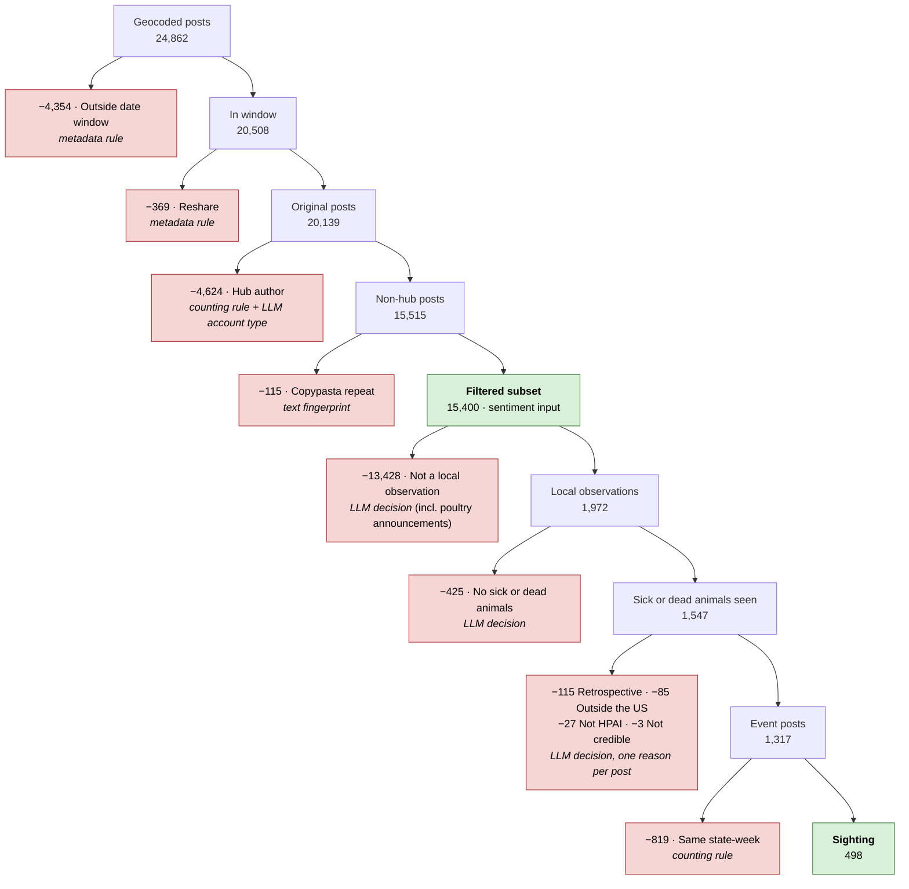

# Meta data funnel: from every collected post to a few hundred sightings

*Nick, 2026-11-11. Counts are rows of Cloud SQL tables. Every post in the funnel's input, with its
disposition, is in the table `meta_post_funnel` (built by `h5n1/sources/meta_funnel.py`). This is
the Meta counterpart of `docs/x_data_funnel.md` and follows the same steps wherever the source
allows.*

We hold 301,044 unique public Facebook posts that mention bird flu. **541 survive as sightings**:
posts describing sick or dead wild birds or animals at a named place in a US state, in roughly the
week they were seen. That is about 1 in 560 posts.

Each step removes posts for **one reason only** and names **the technique** that made the call. The
bold step name is the exact value of `disposition` in `meta_post_funnel`. A post's disposition is
the first step that removes it; a post that survives every step is a **Sighting**. Step numbers
match the X funnel; Meta has no steps 1, 4 or 5 of its own (Max's upstream steps cover them).

## Where the posts come from

The posts are a Meta Content Library export pulled through the UI by Muthu and handed over in
October 2026. Max loaded them into Cloud SQL:
- `meta_post`: 485,534 raw rows, one per search hit.
- `meta_post_unique`: one row per post.
- `meta_post_analysis`: his geocoding and dispositions.
- `meta_post_sentiment`: XLM-R sentiment scores.

> **Data access.** Settled 2026-11-11 (Nick): the team is allowed to save this export in the shared
> database.

## The two streams

| Stream | Language (`lang`) | Dates kept | Posts in Max's geocoded set |
|---|---|---|---:|
| **en** | English | 2022-06-01 on | 24,862 |
| **es** | Spanish | 2022-06-01 on | 5,507 |

There is one collector throughout. Unlike X, there is no change of source on 2025-01-01, so the
streams split only on language.

## The techniques

| Technique | What it means here | Reproducible? |
|---|---|---|
| **Max's pipeline** | Dedup, geocoding from post text, and his own content cuts. His code is not in the repo. | Not from the repo |
| **Metadata rule** | A field Meta supplies: the post date or the post type. | Exactly |
| **Counting rule** | A threshold on how many posts an author or a state-week has. | Exactly |
| **Text fingerprint** | Posts whose cleaned first 80 characters are identical. | Exactly |
| **LLM decision** | Claude subagents (Sonnet) read each post and answer written questions. | Judgement; audited |
| **Reviewed correction** | A reader's answer overridden by hand, with the reason logged in `labels/corrections.csv`. | Exactly, once written |

## Before the funnel: Max's steps

The funnel starts from Max's **30,369 geocoded posts** (`meta_post_analysis WHERE use_sentiment`).
His steps came first and are taken as given:

| Max's disposition | Posts |
|---|---:|
| No US state | 139,391 |
| Foreign or multi-state | 56,748 |
| No keyword in text | 37,134 |
| Copypasta repeat (his rule) | 36,961 |
| Hashtag farm | 441 |
| **Candidate: our input** | **30,369** |

**Location is the post's text, not its author.** Meta gives no profile location. Max's geocoder
matches place names in the text, which means:
- the state is where the post talks about, not where the author lives;
- most of the 30,369 are tied to a state only (27,757);
- 2,026 posts reach a county;
- 586 are city plus state.

On 2026-11-11 we fixed `state` for the 1,472 county rows, which held numeric FIPS codes rather
than USPS codes.

## At a glance (English stream)

## Both streams

Rows in **bold** are what remains. Other rows count the posts removed at that step.

| # | Disposition | What it means | Technique | en | es | Total |
|---|---|---|---|---:|---:|---:|
| | **Max's geocoded set** | | Max's pipeline | **24,862** | **5,507** | **30,369** |
| 2 | Outside date window | Posted before 2022-06-01 | Metadata rule | 4,354 | 547 | 4,901 |
| 3 | Reshare | A reshare of another post | Metadata rule | 369 | 23 | 392 |
| 6 | Hub author | Top 1% by volume, not farm or ag | Counting rule | 4,624 | 909 | 5,533 |
| 7 | Copypasta repeat | Later copy of a mass-posted text | Text fingerprint | 115 | 58 | 173 |
| | **Filtered subset** (`use_sentiment`) | | | **15,400** | **3,970** | **19,370** |
| 8 | Not a local observation | Not a local observation, including every poultry-flock announcement | LLM decision | 13,428 | 3,609 | 17,037 |
| 9 | No sick or dead animals | Local, but no illness seen | LLM decision | 425 | 15 | 440 |
| 10 | Retrospective | Event more than ~30 days before the post | LLM decision | 115 | 56 | 171 |
| 11 | Outside the US | Event is outside the US | LLM decision | 85 | 176 | 261 |
| 12 | Not HPAI | Tested negative, or another cause | LLM decision | 27 | 9 | 36 |
| 13 | Secondhand | Relayed from elsewhere, no local link | LLM decision | 0 | 0 | 0 |
| 14 | Not credible | Joke, sarcasm or conspiracy | LLM decision | 3 | 0 | 3 |
| 15 | Same state-week | Same state and week as an earlier sighting | Counting rule | 819 | 62 | 881 |
| | **Sighting** (`use_sightings`) | | | **498** | **43** | **541** |

Steps 10–14 include 32 reviewed corrections, and step 8 includes 11 more (see "Corrections" below).

## Step by step

Examples are quoted with handles replaced by `@user` and links by `[link]`, and are shortened.

### 2. Outside date window · *Metadata rule*

Posts before 2022-06-01, the start of the study period, are dropped. The export reaches back to
December 2021. Nothing is dropped at the late end: the data run to 2026-07-31.

### 3. Reshare · *Metadata rule*

Meta has no quote posts. The closest thing is a reshare: someone's comment on top of another
post. A post is a reshare if `content_type` is `reshare` or it has a `shared_post_id`. Reshares are
dropped, as X dropped quote posts.

Examples:
- "VDACS is proud to be part of this task force. As broilers and turkeys represent two out of the
  top three Virginia commodities…"
- "La primera víctima en Estados Unidos en morir de gripe aviar fue un hombre de Luisiana…"

### 6. Hub author · *Counting rule*

A hub is an author in the top 1% of a stream's authors by pre-2025 post count, unless the author is
a farmer or an agricultural institution. Hubs post about every state, so their posts carry no local
signal, and all of them are dropped.

More detail and examples

- Volume is counted over **all** of a stream's Meta posts (301,044 in total, located or not) from
  2022-06-01 to 2024-12-31, as X counted over all of a stream's posts.
- **Account type is an LLM decision.** Facebook authors have no bio, so Sonnet readers labelled
  723 authors from their name, username and Page/profile type, using Appendix A of the X funnel.
  The 723 are every top-1% author plus every author whose name has a farm or ag word. Everyone
  else was labelled by the same news-word rule as X, applied to the name.
- **Account types among the geocoded set's authors:**

  | Account type | Authors |
  |---|---:|
  | general_public | 6,974 |
  | media_aggregator | 1,393 |
  | ag_institution | 165 |
  | farmer_keeper | 101 |

- 531 author-streams are hubs.

Largest hubs in the geocoded set:

| Author | Account type | Geocoded posts |
|---|---|---:|
| COEmergency | general_public | 316 |
| Successful Farming | media_aggregator | 174 |
| CIDRAP | media_aggregator | 165 |
| RFD-TV | media_aggregator | 144 |
| Avicultura.mx | media_aggregator | 117 |

### 7. Copypasta repeat · *Text fingerprint*

This is X's rule, unchanged:
- each post's text is lowercased, with links, handles, numbers and punctuation removed;
- the first 80 characters are its fingerprint;
- a fingerprint shared by at least 5 posts from at least 2 authors is copypasta;
- the earliest copy is kept.

Groups form over all of a stream's posts. Max had already removed most copypasta upstream with his
own rule, so this step removes little.

Largest groups:
- "bird flu prompts slaughter of m chickens in nebraska": 18 posts
- "dead florida dolphin was infected with highly pathogenic bird flu": 11 posts
- "bird flu virus likely mutated within a louisiana patient cdc says": 10 posts

**What's left is the filtered subset: 15,400 + 3,970 = 19,370 posts**, flagged `use_sentiment`.
This is the sentiment input:
- Each post's score is Max's `meta_post_sentiment`, from the same XLM-R model as Waree's X scores.
  An independent rescoring of 200 posts matched exactly.
- Sentiment is positive minus negative.
- Every subset post is scored. Sentiment removes nothing; the steps below only find sightings.

### 8. Not a local observation · *LLM decision*

Every subset post was read in 39 batches of 500 by Sonnet subagents. Each answered three questions
from the written guide in Appendix B below: `local_obs`, `illness_seen` and `poultry_announcement`.

Why Meta needed a second version of the guide

The first wave of 13 batches used X's Appendix B unchanged. It went wrong in two ways:

- **Readers disagreed.** Most Meta authors are TV stations, newspapers and agencies. Readers split
  on whether an agency announcement about a named county counts as a local observation, and the
  sick-or-dead rate per batch ranged from 7% to 24%.
- **The outcome leaked in.** A typical "sighting" was "The Arizona Department of Health Services
  says poultry in a backyard flock located in Maricopa County has tested positive". That is a
  USDA-confirmed poultry detection: the outcome we are predicting.

Nick's rule (2026-11-11), which became guide v2:
- **Any announcement of a poultry-flock detection is never a local observation**, even when it
  names the county or farm. It is recorded in `poultry_announcement`.
- **Sick or dead wild birds or wild, zoo or pet mammals at a named place** (county or smaller,
  from a resident, local news or an agency) still count, as in X's "their town's park" rule.
- **An owner describing their own birds in their own words** still counts.

All 39 batches were relabelled under v2. Sick-or-dead rates now run 7.8–12.6% per batch. The v1
labels are archived in `data/Meta_derived/labels/wave1_xguide/`.

2,843 posts are poultry announcements; they are counted under this step. Examples:
- "A commercial broiler breeder chicken flock in Noxubee County has tested positive for highly
  pathogenic avian influenza."
- "Un brote de gripe aviar afecta una granja comercial en Georgia por primera vez"

Other examples answered "no":
- "Federal officials are considering if and when to deploy 4.8 million doses of bird flu vaccine…"
  (policy)
- "Colorado's health department has confirmed four cases of bird flu in Colorado poultry workers…"
  (human cases)

### 9. No sick or dead animals · *LLM decision*

The second question is stricter: does the post describe sick or dead animals, or an infection
among the animals observed? Precautions alone don't count.

Examples (local, but answered "no"):
- "…the tropical [exhibit]… With the discovery of avian bird flu in Arkansas… the health and
  safety of our staff, visitors and animals are our top concerns" (a zoo closing an aviary)
- "The San Diego Humane Society has taken precautions against bird flu…"

### 10–14. The exclusion screen · *LLM decision*

Each sick-or-dead post was read once more against the five written reasons in Appendix C below.
Each post gets at most one reason. The reader sees the text, the post's geocoded state and the
date, never the outbreak data.

More detail and examples

- **Readers.** X gave each stream to one reader. Meta's 1,547 English posts are too many for one
  reader's context, so they were cut into four chunks of about 390 posts in date order. Each chunk
  had its own reader, and all four worked from the same guide. Spanish (352 posts) had one reader.
- **State moves.** When the text places the event in a different US state from the geocoded one,
  the reader moves it (`event_state`). This happened for 19 sightings.
  - For example, "Delaware County NY" had been read as DE.
  - So had the Washington County, Oregon cats, read as WA.
- **Secondhand is empty for Meta.** The state comes from the text, so an event is almost always in
  the post's own state. Where it isn't, it is moved rather than dropped.

**10. Retrospective:**
- "It's MEDICAL MONDAY… WildCareOklahoma released a bald eagle admitted on December 1, 2023"
  (posted February 2024)
- "A bottlenose dolphin found dead in Florida's Dixie County was infected…" (a study of an
  earlier death)

**11. Outside the US.** Most Spanish removals are here: Latin American and Antarctic die-offs that
the geocoder read as US states.
- "La gripe aviar produce desolador paisaje en Península de Valdés…" (Argentina, read as CA)
- "Bird flu has been confirmed in mammals inhabiting South Georgia." (the island, read as GA)

**12. Not HPAI:**
- "The West Virginia Department of Transportation found over 200 dead crows on US 19 North…"
  (another cause)
- "NEGATIVAS A GRIPE AVIAR LAS MUESTRAS TOMADAS DE AVES MUERTAS EN JUANA DÍAZ" (tested negative)

**14. Not credible:** two near-identical first-person posts about "falsified negatives" at an egg
facility, and an apocalyptic post.

### Corrections · *Reviewed correction*

Readers' files are left as written. Overrides live in `data/Meta_derived/labels/corrections.csv`,
45 rows, each with a reason:

| Correction | Posts | Why |
|---|---:|---|
| Poultry announcement leaked through | 11 | A single reader re-read all 209 kept posts that use poultry words and found 11 flock announcements, e.g. "Hickman's Family Farms says bird flu has killed 95 percent of its Arizona flock" |
| Retrospective | 29 | April 2024 echoes, mostly Spanish, of a study of New York City park birds sampled in 2022–23 |
| Retrospective | 2 | Reposts of the December 2024 Washington big-cat sanctuary deaths |
| Retrospective | 1 | A June 2025 post about flock detections the previous December |
| Not an animal sighting | 2 | Human H5N1 case posts |

### 15. Same state-week · *Counting rule*

One die-off is often posted about many times: Meta Pages repost the same story widely. The analysis
counts one sighting per state per week, keeping the earliest post (ties by smallest post ID). The
state is `event_state`. 881 posts shared a state-week with an earlier one. That is far more than
X's 49, because the same news story spreads across many Pages.

**What's left is the Sighting rows: 498 + 43 = 541**, flagged `use_sightings`. Examples:
- "Avian flu leads to increased bird deaths in Northwest Indiana, statewide [link]" (IN)
- "SAFETY ALERT: Don't touch or approach wild birds, especially if they seem sick or dead!…" (PA)

## The `meta_post_funnel` table

There is one row per post in Max's geocoded set: 30,369 rows, keyed by `post_id`.

- **The post:** `stream`, `created_at`, `content_type`, `owner_id`, `owner_name`, `owner_type`,
  `search_terms`, `post_text`.
- **Author:** `account_type`, `hub` (step 6).
- **Location:** `geo_tier`, `geo_matched`, `state`, `county_fips` (Max's), and `event_state`
  (steps 10–14).
- **Copypasta:** `copypasta`, `copypasta_first` (step 7).
- **Labels:** `local_obs`, `illness_seen`, `poultry_announcement`, `exclusion_reason`. These are
  blank for rows that never reached the step.
- **Outcome:** `disposition_step`, `disposition`, `use_sentiment`, `use_sightings`,
  `sighting_week`.

Sentiment input is `WHERE use_sentiment` joined to `meta_post_sentiment`; sightings are
`WHERE use_sightings`. The readers are `meta_funnel.sentiment_posts()` and
`meta_funnel.sightings()`.

To rebuild, run `uv run python -m h5n1.sources.meta_funnel` with each of these steps in order:
`build`, `accounts`, `subset`, `merge`, `table`, then `load` (load needs `DB_PORT=5433`).
- The LLM labels are in `data/Meta_derived/labels/`: `name_labels_*`, `labels_*` and
  `excl_labels_*`, plus `corrections.csv`. A rebuild reads them back rather than re-asking the
  readers.
- **Back them up before anything else.** A second reading would not give the same answers, and,
  unlike X, the table is not yet treated as their record of truth.

## What this means

- **Meta is mostly institutional news.** About 95% of posts come from Pages. Hubs are news outlets
  and trackers, and the remaining authors are largely local stations and agencies. Track A
  measures news tone about a state, not public sentiment from it.
- **Location is better covered than on X, but it is a different thing.**
  - Every input post has a state, because Max kept only posts that name one.
  - But the state is the place the post mentions. Steps 10–14 found geocoder misreads, mostly
    foreign places, in about 1 in 7 sick-or-dead posts.
- **The outcome is everywhere in this data.** Poultry announcements make up 15% of the filtered
  subset, more than the sick-or-dead posts. The sighting signal depends on excluding them, which
  is an LLM judgement. An audit of the posts that use poultry words found a 5% leak rate; posts
  without those words were not audited.
- **Sightings are mostly news of wildlife die-offs**, not personal observations. Under the
  guide's local-news rule they count, as they did for X. But they are reports that have usually
  already reached officials.
- **Where judgement enters:**
  - steps 8–14 are LLM decisions;
  - the step 6 farm exemption uses LLM account types;
  - 45 answers were corrected by hand with logged reasons;
  - Max's upstream steps cannot be reproduced from the repo.

## Appendix A: account types (step 6)

The same as X's Appendix A, applied to the author's name, username and Page/profile type, because
Facebook authors have no bio. Spanish names follow the same rules: "Noticias…" is media, "Granja…"
is a farmer, and SENASA or SADER are ag institutions.

## Appendix B: local observation, guide v2 (steps 8 and 9)

The full guide is `data/Meta_derived/labels/GUIDE_local_obs.md`. Three yes/no questions per post;
the reader sees only the text.

1. **`local_obs`: is this a local observation?**
   - **Yes** for:
     - something the author or someone near them saw or experienced;
     - sick or dead wild birds or wild, zoo or pet mammals at a named place, county level or
       smaller, reported by a resident, local news or an agency;
     - a precaution described as happening at a named local place.
   - **No** for:
     - **any announcement of a confirmed or suspected HPAI detection in a poultry flock**, unless
       it is the owner describing their own birds;
     - statewide or national news, counts and maps;
     - human cases, prices, policy, advice, opinion and jokes;
     - agency announcements of dairy-herd detections.
2. **`illness_seen`: does the post describe sick or dead animals?**
   - **Yes** only if `local_obs` is yes and the post describes sick or dead animals or an
     infection among them.
3. **`poultry_announcement`: is the post a poultry-flock detection announcement?**
   - **Yes** if it is. A poultry announcement always has `local_obs` = no.
   - A post that mixes a poultry detection with a separate wild-bird or mammal die-off at a named
     place is a local observation, not a poultry announcement. This rule was added from batch 13
     onward; batches 0–12 decided such posts case by case, about one per batch.

## Appendix C: exclusion screen (steps 10–14)

The full guide is `data/Meta_derived/labels/GUIDE_exclusion.md`. It is X's Appendix C, except that
the reader sees the post's geocoded state rather than the author's profile state. Reasons are
checked in this order:
1. `outside_us`
2. `retrospective` (more than about 30 days)
3. `not_hpai`
4. `secondhand`
5. `not_credible`

Hawaii, Alaska and the territories count as US. If the text places the event in a different US
state, the post is kept and moved there (`event_state`).
