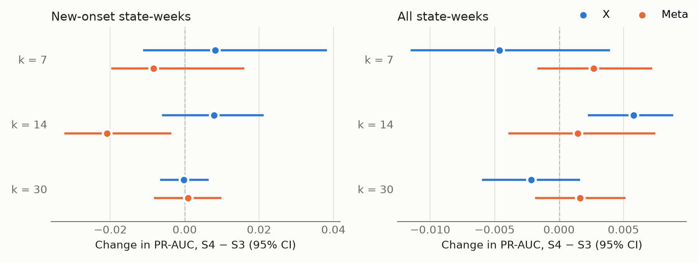
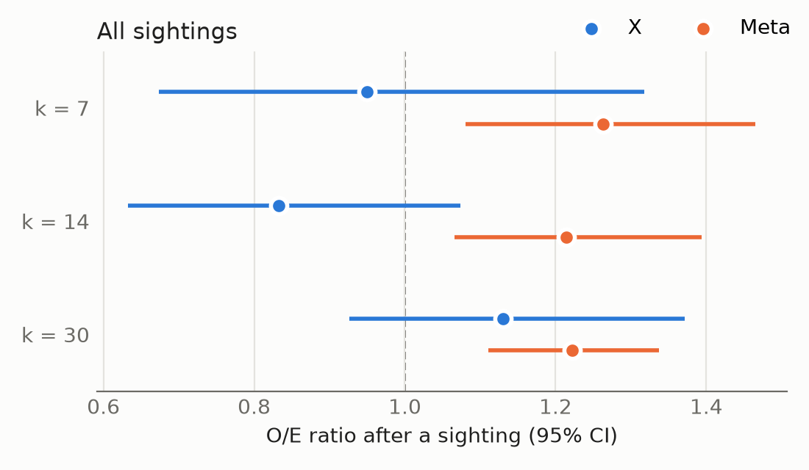

# Data, methods and results: working draft for the paper

*Nick, 2026-11-12. A single view of the data and models the team has built, meant to be rewritten
by hand into the paper. **Everything in this document is exploratory.** Every number is traced to a
saved file in [Where each number comes from](#where-each-number-comes-from); check against it when
rewriting.*

Not covered here, to be analysed later: differences between languages, and the effect of emoji on
sentiment.

---

## 1. Data

### 1.1 Base data: outbreaks, surveillance, exposure and environment

The outcome is a USDA-confirmed outbreak of highly pathogenic avian influenza (HPAI) in domestic
birds. USDA APHIS publishes each confirmed detection with its county and confirmation date: 2,090
county-day records from 2022-02-08 to 2026-07-13. Every model forecasts whether a place will have
one of these confirmations in the next 7, 14 or 30 days.

The predictors describe what was already knowable when a forecast is made. They fall into five
groups:
- **Recent outbreak history:** the place's own recent confirmations, and those of its neighbours.
- **Wild-bird surveillance:** APHIS HPAI detections in wild birds. These are a main route of
  infection into flocks.
- **Migration pressure:** wild-bird infections weighted by where they sit relative to the county
  along its flyway, toward the breeding grounds and toward the wintering grounds.
- **Exposure:** how many poultry operations a place has, and of which kind, from the USDA NASS 2022
  Census of Agriculture. Human population comes from the Census.
- **Weather:** recent temperature and precipitation from NOAA.

The base surface holds one row per county per day, 3,143 counties on 2021 Census geography. It is
also summed to one row per state per week, which is the grain of the social-media analysis (see
[2.1](#21-grain-why-social-media-is-tested-at-state-week-level)).

Two windows of each count are used throughout: trailing 7, 21 and 60 days. Counts are
log-transformed. A missing value keeps its meaning and is never filled with 0:
- NASS withholds layer inventory in some counties to protect confidentiality. That means unknown,
  not zero.
- No weather reported means missing weather, not 0 degrees.
- No outbreak in the past year is censored, with a flag that says so.

### 1.2 X (Twitter)

X posts that mention bird flu came from two collectors:
- **Before 2025:** the previous cohort's scraper, in English. It covers 2022-06 to 2024-12.
- **2025 on:** twitterapi.io, with different search terms. It also supplied all the Spanish and
  French posts, from 2022-06.

In total there are 603,265 rows. X posts carry no geotag. A post is placed in a US state only when
the free-text location in the author's profile matches Census place names by fixed rules. That
places about 1 post in 5. Too few posts reach county level for any county use.

X enters the models in two ways:
- **Volume and sentiment (Track A).** These come from the filtered subset: posts placed in a state,
  after removing duplicates, the highest-volume non-farm accounts and mass-copied text. Sentiment
  comes from a multilingual model (XLM-RoBERTa, `cardiffnlp/twitter-xlm-roberta-base-sentiment`).
  It is scored as positive minus negative probability, in each post's own language, with no
  translation.
- **Sightings (Track B).** A sighting is a post in which someone reports sick or dead animals seen
  locally and recently. Claude (Sonnet) subagents read every filtered post and answered fixed
  yes/no questions to identify them.

### 1.3 Meta (Facebook)

The Meta data is a Meta Content Library export of public Facebook posts that mention bird flu. It
was pulled through the Library's web interface. It holds 485,534 search hits, which are 301,044
unique posts.

Max geocoded the posts from the place their text names, not from the author's location. He then
selected the 30,369 posts placed in a single US state. *(Details of that step to be added.)*

From there the posts went through the same steps as X:
- the same subset rules;
- sentiment from the same XLM-R model family, scored in-language;
- an LLM reading for sightings.

The authors are a different population from X's. Most Meta posts come from Pages: local
newsrooms, agencies and organisations. A Meta sighting is therefore usually local news or an agency
notice of a wildlife die-off, rather than a resident's own report.

### 1.4 Variables

One table for every model. ✓ means the variable is in that model. The county model (C3) uses
Waree's full set of 35 features. The state baseline (S3) uses the state-week versions of the same
quantities, 37 features. Variable names are those in `model_county_day_35` and `model_state_week`.

| Variable | Description | Source | County C3 | State S3 | Social models |
|---|---|---|:-:|:-:|:-:|
| `doy_sin`, `doy_cos` | Day of year as sine and cosine (season) | Calendar | ✓ | ✓ | |
| `log_poultry_operations` | Poultry operations, all kinds | USDA NASS 2022 Census of Agriculture | ✓ | ✓ | |
| `log_broiler_operations`, `log_turkey_operations`, `log_duck_operations` | Operations by flock type | USDA NASS 2022 | ✓ | ✓ | |
| `log_layer_inventory` (county); `log_known_layer_inventory`, `layer_withheld_share` (state) | Laying-hen inventory. The state sum covers only reported counties, so the share in withheld counties travels with it | USDA NASS 2022 | ✓ | ✓ | |
| `layer_inventory_suppressed` | NASS withheld the county's layer inventory | USDA NASS 2022 | ✓ | | |
| `log_layer_operations` | Laying-hen operations | USDA NASS 2022 | ✗ collinear with poultry operations | ✗ | |
| `log_population` | Human population | US Census | ✓ | ✓ | |
| `n_neighbors` / `n_neighbor_states` | Adjacent counties / states | Census adjacency | ✓ | ✓ | |
| `log_own_outbreaks_{7,21,60}d` / `log_outbreaks_{7,21,60}d` | Confirmed outbreaks in the county / state, trailing windows | USDA APHIS | ✓ | ✓ | |
| `log_infected_counties_{7,21,60}d` | Counties in the state with an outbreak | USDA APHIS | | ✓ | |
| `days_since_outbreak_county` / `days_since_outbreak`, with `_censored` flag | Recency of the last outbreak, censored after 365 days | USDA APHIS | ✓ | ✓ | |
| `log_nbr_infections_{7,21,60}d` / `log_nbr_outbreaks_{7,21,60}d` | Outbreaks in neighbouring counties / states | USDA APHIS + adjacency | ✓ | ✓ | |
| `log_nbr_infected_counties_{7,21,60}d` | Infected counties among the neighbours | USDA APHIS + adjacency | ✓ | ✓ | |
| `days_since_outbreak_neighbor` / `days_since_outbreak_nbr`, with `_censored` flag | Recency of the last neighbouring outbreak | USDA APHIS + adjacency | ✓ | ✓ | |
| `log_wild_detections_{7,21,60}d` | HPAI detections in wild birds, own county / state | USDA APHIS wild-bird surveillance | ✓ | ✓ | |
| `log_nbr_wild_detections_{7,21,60}d` | Wild-bird detections in neighbours | USDA APHIS + adjacency | ✓ | ✓ | |
| `log_breeding_side_pressure`, `log_wintering_side_pressure` | Wild-bird infections within 300 km, weighted by direction along the flyway | Derived: APHIS wild-bird detections + flyway geometry | ✓ | ✓ | |
| `temp_min_7d_c`, `temp_max_7d_c`, `precip_7d_mm` | Trailing 7-day weather; state values are operations-weighted county means | NOAA | ✓ | ✓ | |
| `weather_missing` | No station reported | NOAA | ✓ | | |
| Bird-banding counts | Banded high-risk waterfowl | USGS Bird Banding Lab | ✗ ends 2025-07-10, inside the test window | ✗ | |
| GDELT news volume and tone | News articles about bird flu | GDELT 2.0 | ✗ tested and rejected, see [1.7](#17-gdelt-news-tested-and-rejected) | ✗ | |
| `x_share_7d` | The state's share of national posts in the trailing 7 days (volume) | X or Meta, filtered subset | | | Track A |
| `x_sent_7d` | Mean post sentiment in the state, trailing 7 days, shrunk toward the state's usual level when posts are few | X or Meta, XLM-R | | | Track A |
| `x_sent_chg` | That sentiment minus the state's usual sentiment in training | X or Meta, XLM-R | | | Track A |
| Sighting | At least one sighting posted in the state that week | X or Meta, LLM reading | | | Track B |
| Dropped social candidates | Raw post count, anomaly score, share of negative posts, non-media sentiment | X | | | ✗ |

The social candidates were dropped before any outcome was used:
- **Raw post count and anomaly score:** both changed about tenfold at the X collector break.
- **Negative share and non-media sentiment:** each correlated about 0.92 to 0.96 with `x_sent_7d`.

Meta uses the same three Track A features as X.

**The sighting is an input, not a model feature.** A sighting decides which state-weeks are
examined: Track B looks only at weeks that had one. It is not a column a model learns a weight for,
because every examined row has a sighting, so a weight on it could not be estimated. What Track B
measures is whether outbreaks follow those weeks more often than the baseline already predicted.
Section [2.3](#23-two-ways-social-media-can-help-track-a-and-track-b) explains why the tracks were
set up this way.

### 1.5 Spanish and French

Spanish and French posts were collected so that the analysis would not depend on English alone. In
the event, they contribute little:

| | X Spanish | X French | Meta Spanish |
|---|---:|---:|---:|
| Posts collected (unique) | 65,355 | 15,186 | (in the 301,044) |
| Placed in a US state | 850 | 141 | 5,507 (in Max's 30,369) |
| Filtered subset (Track A input) | 764 | 140 | 3,970 |
| Sightings | 1 | 0 | 43 |

How the non-English posts were handled:
- **Geography.** Most Spanish and French X profiles name places outside the US. The geocoder drops
  them, and a word list removes place names in each language's region. French profiles are first
  mapped to English US place names ("Louisiane" → "Louisiana").
- **Sentiment.** The XLM-R model scores Spanish and French directly, with no translation, and the
  scores are pooled with English into each state's weekly features.
- **Sightings.** The readers read Spanish and French posts in the original language.

Meta has no French stream. Its Spanish posts are a sizeable share of the Meta subset (20%) and of
its sightings (8%).

Whether sentiment differs by language is not tested here.

### 1.6 From all posts to the modelled data

Each step removes posts for one reason, and a post's step is the first one that removes it. Bold
rows are what remains. "LLM decision" means Claude (Sonnet) subagents read every post and answered
written yes/no questions.

Sightings on both platforms use the Meta guide v2 definition, under which an announcement of a
poultry-flock detection is never a sighting (see the note below the table). Full step-by-step
detail with examples is in `docs/x_data_funnel.md` and `docs/meta_data_funnel.md`.

| # | Step | What it removes | Technique | X | Meta |
|---|---|---|---|---:|---:|
| | **Rows collected** | | | **603,265** | **485,534** |
| 1 | Duplicate search result | The same post returned by more than one search | ID match | 63,001 | 184,490 |
| 2 | Outside date window | Posted outside the stream's dates | Metadata rule | 26,253 | — |
| 3 | Quote post | A quote of another post | Metadata rule | 11,159 | — |
| | **Unique posts** | | | **502,852** | **301,044** |
| — | Not selected by Max's geocoding | No single US state, foreign, no keyword, his copypasta rule *(details to be added)* | Max's pipeline | — | 270,675 |
| 4 | No US state | Profile location does not resolve to one US state | Word mapping | 397,599 | — |
| 5 | Foreign place name | Profile names a place outside the US | Word list | 394 | — |
| | **Placed in a US state** | | | **104,859** | **30,369** |
| 2 | Outside date window | Posted before 2022-06-01 | Metadata rule | — | 4,901 |
| 3 | Reshare | A reshare of another post | Metadata rule | — | 392 |
| 6 | Hub author | Top 1% of authors by volume, not farm or agriculture | Counting rule | 31,156 | 5,533 |
| 7 | Copypasta repeat | A later copy of mass-posted text | Text fingerprint | 6,750 | 173 |
| | **Filtered subset (Track A input)** | | | **66,953** | **19,370** |
| 8 | Not a local observation | Not first-hand or near first-hand; includes every poultry-flock announcement | LLM decision | 65,884 | 17,037 |
| | **Local observations** | | | **1,069** | **2,333** |
| 9 | No sick or dead animals | Local, but no illness seen | LLM decision | 681 | 440 |
| | **Sick or dead animals seen** | | | **388** | **1,893** |
| 10 | Retrospective | Event more than about 30 days before the post | LLM decision | 51 | 171 |
| 11 | Outside the US | Event is outside the US | LLM decision | 24 | 261 |
| 12 | Not HPAI | Tested negative, or another cause | LLM decision | 5 | 36 |
| 13 | Secondhand | Relayed from outside the author's state | LLM decision | 31 | 0 |
| 14 | Not credible | Joke, sarcasm or conspiracy | LLM decision | 5 | 3 |
| | **Event posts** | | | **272** | **1,422** |
| 15 | Same state-week | Same state and week as an earlier sighting | Counting rule | 47 | 881 |
| | **Sightings (Track B input)** | | | **225** | **541** |

The funnel ends in posts, but the models work on state-weeks, and only 2025+ is scored. The test
window is the Sundays from 2025-01-05 to 2026-07-13. In it, the modelled units are:

| Test-window units, k = 14 | X | Meta |
|---|---:|---:|
| State-weeks in the test window | 3,822 | 3,822 |
| … followed by an outbreak | 703 | 703 |
| Track A rows: state-weeks with at least 1 subset post | 1,710 | 1,565 |
| … new-onset state-weeks (primary Track A rows) | 1,043 | 825 |
| … of which followed by an outbreak | 135 | 134 |
| Track B rows: test-window sightings, one per state-week | 59 | 275 |

**Note: X's two English collectors.** X's English posts switch source on 2025-01-01, the same day
training ends and testing begins:

| | Prior cohort's scraper (2022-06 to 2024-12) | twitterapi.io (2025 on) |
|---|---:|---:|
| Rows collected | 426,291 | 78,591 |
| Filtered subset | 57,921 | 8,128 |
| Sightings (v2) | 165 | 59 |

The two collectors used different search terms, and English post volume falls about tenfold across
the change. That is why Track A uses each state's share of national posts rather than raw counts:
a share survives a change in total volume.

The Spanish and French X posts came from twitterapi.io throughout. Because of the break, the X
model is trained on one collector and tested on another. Meta has a single collector throughout.

Two notes on the Meta column:
- **Steps 2 and 3 run after the geography step.** Max's selection came first, so these Meta counts
  sit below "Placed in a US state".
- **Step 13 removes nothing.** For Meta the state is the place a post talks about, not the author's
  home, so a post cannot be relayed from outside the author's state.

**Note: the sighting definition (Meta guide v2 vs the X guide).** The X posts were first read under
guide v1. Under v1, any local report of sick or dying animals counted, including a relayed "the
county confirmed bird flu at a farm near us".

Meta guide v2 (2026-11-11) adds one rule: an announcement or news of a confirmed or suspected HPAI
detection in a poultry flock is never a sighting, because it is the outcome being predicted. The
owner describing their own birds falling sick in their own words still counts. The rule was needed
for Meta because most Meta authors are news Pages announcing flock detections.

To put both platforms on one definition, every X post the v1 readers had marked a local observation
(1,156) was re-read for that one question, and 4 calls were reviewed and overridden.
- **87 posts were poultry-flock announcements** and moved to step 8. 19 of them had been
  sightings.
- **X sightings went from 243 to 225** (in the test window, from 62 to 59) after replacements
  within the same state-week.
- **The X Track B result barely moved:** the k=14 O/E ratio went from 0.85 (0.67 to 1.09) to 0.83
  (0.63 to 1.07).

So the difference between the X and Meta results is not caused by the definition. This document
reports X under v2. The v1 figures are in `docs/x_utility_results.md`.

### 1.7 GDELT news: tested and rejected

Before the X and Meta data were in hand, we tested news coverage from GDELT as a stand-in for
public attention. GDELT is a global index of online news.

From its Global Knowledge Graph we took every article tagged with a bird-flu theme from 2022-01 to
2026-07: 169,953 articles, collapsed to 111,665 stories once syndicated copies were merged. Each
article carries the places it names and a tone score. These were built into county, state and
national features of article volume and tone, and added to the county forest.

GDELT was rejected for four reasons:
- **It did not help, and at state level it hurt.** Adding state and national GDELT features lowered
  the county model's PR-AUC by 0.0115 (95% CI −0.0175 to −0.0046). County features were a null:
  −0.0019 (−0.0049 to +0.0019). On new-onset counties the county features gave +0.0007 (−0.0000 to
  +0.0015), which does not exclude zero.
- **It soaked up importance without adding skill.** The GDELT columns took 25.8% of the forest's
  impurity importance while predictions got no better. That is the pattern of a variable that
  describes outbreaks rather than anticipates them.
- **News follows outbreaks.** Within states, weekly article counts correlate most with outbreaks in
  the same week and the week before. They correlate least with the weeks after.
- **Affect did not help either.** A follow-up tested five GCAM affect dimensions specified in
  advance: anxiety, tentativeness, death, uncertainty and negativity. All were null.

GDELT also has known geographic distortions. State-level mentions are placed at the state's
centroid, and Washington DC is inflated by White House datelines.

GDELT is news, not social media, so it is reported here as a related negative result and not as a
third platform. Source: `notebooks/gdelt_lift.ipynb` and `notebooks/gdelt_gcam_screen.ipynb`.

---

## 2. Methods

### 2.1 Grain: why social media is tested at state-week level

The county baseline forecasts at county-day level, the grain at which assets would be deployed.
Social media cannot be tested there:
- **X:** about 1% of county-days have a geocoded post, because the profile location is usually a
  state or a large city.
- **Meta:** posts are placed by the place their text names, and most name a state or a region
  rather than a county.

Every social-media comparison is therefore made at state-week level. A state-week is one state in
one week ending Sunday, and the forecast is made at the end of that Sunday. The 48 contiguous
states plus DC are included.

### 2.2 Models

Every model is the same shallow random forest: 300 trees, depth 6, minimum leaf size 2, three seeds
averaged. There is no hyperparameter search, because tuning on a 2024 validation window made the
county model worse on 2025 (see [Limits](#4-limits)).

| Model | Grain | Contents | Role |
|---|---|---|---|
| **C3**, county baseline (Waree) | County-day | The 35 features in 1.4 | The model that would be deployed. Reported on its own, and rolled up to state-weeks for comparison |
| C3 roll-up | State-week | C3's county forecasts on the Sunday, combined as 1 − ∏(1 − p) over the state's counties: the chance that any county has an outbreak | Puts the county model on the social-media grain |
| **S0** | State-week | Season, poultry exposure, population, neighbour count | Floor: place and season alone |
| **S1** | State-week | Social media only (3 features) | Does social media have skill on its own? |
| **S2** | State-week | S0 + social media | Does it know anything beyond season and place? |
| **S3**, state baseline | State-week | S0 + recent outbreaks, neighbours, wild birds, migration, weather (37 features) | The reference that social media must improve |
| **S4** | State-week | S3 + social media | Does social media add beyond surveillance? |
| S4v, S4s | State-week | S3 + volume only; S3 + sentiment only | Which part contributes |

### 2.3 Two ways social media can help: Track A and Track B

Social media could carry an early warning in two different ways, so they are tested separately.
They use different rows and answer different questions, and there is no single combined number.

**Track A: sentiment and volume.**
- **The idea:** a state where people are posting more about bird flu, or more negatively, is about
  to have an outbreak.
- **How it is tested:** the three features are added to the state models, and the forecasts are
  compared with and without them (S4 vs S3).
- **Rows:** state-weeks with at least one filtered post. A week with no posts has no row and
  nothing is imputed, so every arm is scored on the same rows.

**Track B: sightings.**
- **The idea:** a person or a local newsroom reports dead birds before the flock outbreak is
  confirmed.
- **How it is tested:** sightings are rare (59 X and 275 Meta state-weeks in the test window), too
  few to learn a model weight from. Each sighting is treated as an alert instead.
- **The question:** in the weeks with a sighting, did more outbreaks follow than S3 already
  expected?
- **Rows:** S3 is trained on all state-weeks, and its forecast supplies the expected risk.

### 2.4 Measures

- **Horizon k:** whether an outbreak is confirmed in the state within k = 7, 14 or 30 days after
  the forecast Sunday. The primary horizon is k = 14.
- **New onset:** a state-week with no confirmed outbreak in that state in the prior 30 days. That
  is where early warning matters most, and it is the primary slice for Track A.
- **PR-AUC (average precision):** how well a model ranks the rare positive weeks. A model with no
  skill scores the base rate. Accuracy is not used, because always predicting "no outbreak" would
  score well. Track A's primary measure is the change in PR-AUC, S4 − S3.
- **O/E ratio:** Track B's primary measure. Outbreaks that followed sightings, divided by the
  outbreaks S3 expected for those weeks, then divided by the same observed/expected figure for weeks
  without a sighting. The second division cancels any general miscalibration of S3. 1.0 means
  sightings add nothing; above 1 means they add warning.
  - S3's forecasts are calibrated (Platt scaling) by leave-one-season-out within training.
- **Season-and-place match:** the outbreak rate after a sighting, compared with the rate in the
  same state at the same time of year (±15 days) in other years.
- **Confidence intervals:** paired bootstrap over weeks, 2,000 replicates, 95%. Whole weeks are
  resampled because states in the same week share an epidemic.
- **Robustness checks:**
  - an embargo that ends the social-media window 5 days before the forecast, to catch posts that
    react to an outbreak announced locally before APHIS confirms it;
  - a block permutation of social media within state and season.

### 2.5 Training, validation and test periods

| Model | Training | Validation | Test |
|---|---|---|---|
| State-week models (S0–S4) | 2022-08-07 to 2024-12-31, minus k days so no training outcome falls in the test period. The start is the first Sunday whose trailing window begins after the first post | Forward-chaining folds, used to choose features and design: **F1** train to 2023-09-30, validate 2023-10-01 to 2024-03-31; **F2** train to 2024-03-31, validate 2024-04-01 to 2024-09-30; **F3** train to 2024-09-30, validate 2024-10-01 to 2024-12-31 | Sundays from 2025-01-05 whose outcome window ends by 2026-07-13, the last loaded confirmation |
| S3 as Track B's expected risk | Same as above | Platt calibration fitted leave-one-season-out inside training | Same as above |
| County C3 | 2022-02-08 to 2024-12-31, minus k days. Negatives are sampled at 5% and weighted back | None used for the final fit: hyperparameters are fixed. A 2024-H2 validation window was tried for tuning and rejected | Every contiguous-US county-day from 2025-01-01 whose outcome window ends by 2026-07-13 |
| C3 roll-up | As C3 | None | The test Sundays above |

### 2.6 How the results feed a decision

The purpose is to decide where to send response assets ahead of an outbreak. The county model C3 is
the tool that would be used, because it points to counties. Social media can only point to states.
The decision rule is:

1. Roll C3 up to state-weeks and compare it with the best state model that uses social media, on
   the same rows.
2. If the roll-up does at least as well, social media is skipped and the county model is used
   alone.
3. If a social-media model does better, the team makes a qualitative choice. The options are an
   earlier but statewide signal from social media, or the county model's targeted signal.

---

## 3. Results

### 3.1 Baselines

**County model C3 (Waree's forest, 35 features), 2025+ test.** It covers every county-day, so its
base rates are far lower than at state level and its numbers are not comparable with the
state-week tables.

| k | Slice | Positives | Base rate | PR-AUC | Lift over base rate | ROC AUC |
|---|---|---:|---:|---:|---:|---:|
| 7 | All | 4,360 | 0.25% | 0.143 | 56.1× | 0.878 |
| 7 | New onset | 2,973 | 0.18% | 0.016 | 9.0× | 0.834 |
| 14 | All | 7,795 | 0.46% | 0.130 | 28.2× | 0.862 |
| 14 | New onset | 5,797 | 0.35% | 0.027 | 7.7× | 0.828 |
| 30 | All | 14,596 | 0.89% | 0.131 | 14.8× | 0.841 |
| 30 | New onset | 11,758 | 0.73% | 0.046 | 6.3× | 0.816 |

C3 ranks counties 6 to 56 times better than chance. It is much weaker on a county's first outbreak
than on continuing ones. Recent outbreak history carries most of its skill.

**C3 rolled up to state-weeks against the state baseline S3.** Every 2025+ state-week, with no
social media. The roll-up is the chance that any county in the state has an outbreak, from C3's
county forecasts on the Sunday.

| k | Slice | State-weeks (positive) | Base rate | S3 | C3 roll-up | S3 − roll-up (95% CI) |
|---|---|---:|---:|---:|---:|---|
| 7 | All | 3,871 (459) | 0.119 | 0.482 | 0.508 | −0.026 (−0.043 to −0.008) |
| 7 | New onset | 2,714 (138) | 0.051 | 0.182 | 0.146 | +0.036 (+0.001 to +0.077) |
| 14 | All | 3,822 (703) | 0.184 | 0.558 | 0.556 | +0.002 (−0.013 to +0.017) |
| **14** | **New onset** | **2,670 (254)** | **0.095** | **0.282** | **0.240** | **+0.042 (+0.014 to +0.075)** |
| 30 | All | 3,675 (1,086) | 0.296 | 0.674 | 0.657 | +0.017 (+0.001 to +0.033) |
| 30 | New onset | 2,538 (470) | 0.185 | 0.456 | 0.396 | +0.060 (+0.024 to +0.093) |

What this shows:
- **On all state-weeks the two are close.** The roll-up is better at k = 7, they are equal at
  k = 14, and S3 is slightly better at k = 30. Much of the all-rows skill is in states with an
  outbreak already under way, where C3's county-level history is precise.
- **On new onsets the state model is clearly better at every horizon.** At k = 14 it scores 0.282
  against 0.240. A state's first outbreak in a month is easier to anticipate from statewide and
  neighbouring-state signals than by adding up county risks that are each tiny.
- **This held in 2022-24 as well.** In the validation folds S3 beat the roll-up at every k, by
  0.263 against 0.170 on new onsets at k = 14.
- **The comparison slightly favours S3.** The county predictors stop the day before the forecast
  Sunday, while the state ones include it.

So the answer to "which state?" and the answer to "which county?" come from different models. That
matters for reading the decision rule in [3.4](#34-summary-for-the-deployment-decision).

### 3.2 Track A: sentiment and volume

**Arms on the primary rows.** Test window, k = 14, new-onset state-weeks with at least one post. X
and Meta have different rows, so S3 scores differently on each, and each column must be read
against its own base rate and its own S3.

| Arm | Contents | X PR-AUC | Meta PR-AUC |
|---|---|---:|---:|
| | *Rows (followed by an outbreak)* | *1,043 (135)* | *825 (134)* |
| | *Base rate* | *0.129* | *0.162* |
| S0 | Place, season, exposure | 0.293 | 0.332 |
| S1 | Social media only | 0.130 | 0.138 |
| S2 | S0 + social media | 0.271 | 0.287 |
| S3 | State baseline | 0.346 | 0.395 |
| S4 | S3 + social media | 0.354 | 0.374 |
| S4v | S3 + volume only | 0.351 | 0.393 |
| S4s | S3 + sentiment only | 0.348 | 0.387 |
| C3 roll-up | Waree's county model summed to the state | 0.263 | 0.293 |

**S4 − S3, change in PR-AUC with 95% CI, by horizon:**

| k | Slice | X | Meta |
|---|---|---|---|
| 7 | All | −0.005 (−0.012 to +0.004) | +0.003 (−0.002 to +0.007) |
| 7 | New onset | +0.008 (−0.011 to +0.038) | −0.008 (−0.020 to +0.016) |
| 14 | All | +0.006 (+0.002 to +0.009) | +0.002 (−0.004 to +0.008) |
| **14** | **New onset** | **+0.008 (−0.006 to +0.021)** | **−0.021 (−0.032 to −0.004)** |
| 30 | All | −0.002 (−0.006 to +0.002) | +0.002 (−0.002 to +0.005) |
| 30 | New onset | −0.000 (−0.007 to +0.006) | +0.001 (−0.008 to +0.010) |

*The two panels use different horizontal scales. The dashed line is no change.*

**Checks at k = 14:**

| Check | X, all | X, new onset | Meta, all | Meta, new onset |
|---|---|---|---|---|
| Volume only, S4v − S3 | +0.000 (−0.003 to +0.003) | +0.005 (−0.010 to +0.020) | +0.003 (−0.002 to +0.006) | −0.003 (−0.013 to +0.009) |
| Sentiment only, S4s − S3 | +0.003 (−0.002 to +0.007) | +0.002 (−0.010 to +0.015) | +0.000 (−0.004 to +0.005) | −0.008 (−0.020 to +0.011) |
| Social window ending 5 days early | +0.000 (−0.003 to +0.004) | +0.001 (−0.012 to +0.013) | +0.001 (−0.003 to +0.006) | −0.010 (−0.022 to +0.007) |
| Block permutation p | 0.18 | 0.39 | 0.12 | 0.98 |
| Social media's unique share of explained deviance | 0.00% | 0.06% | 0.02% | 0.12% |

What the tables show:
- **Neither platform has skill on its own.** S1 is at the base rate for both.
- **Both make the season-and-place model worse.** S2 is below S0 on both platforms. Social media
  adds noise to that model rather than information.
- **Neither improves the state baseline on new onsets.** X's change is +0.008 with an interval
  across zero. Meta's is −0.021, an interval below zero: Meta made the forecasts worse.
  - Meta's harm is concentrated in 2025-Q1: −0.039 (−0.066 to −0.008). That was the epidemic peak,
    when posting tracked the epidemic everywhere at once.
- **The one positive interval, X on all rows at k = 14 (+0.006), does not survive scrutiny.** It
  is half a point of PR-AUC, the permutation test does not support it, and it disappears when X's
  window ends 5 days early. That pattern fits posts reacting to outbreaks already announced
  locally.
- **Social media reacts rather than leads.** X volume peaks in the week of a state's first
  outbreak and fades afterwards. Lead/lag correlations peak in the same week.
- **Coverage is partial.** Track A can only speak for weeks with posts. At k = 14, X had a post in
  61% of state-weeks followed by an outbreak (53% of new-onset ones); Meta in 65% (53%).

**Against the county model rolled up.** On the primary rows, S4 beats the C3 roll-up on both
platforms, but only because S3 does:

| k = 14, new onset | X | Meta |
|---|---|---|
| S3 − roll-up | +0.083 (+0.037 to +0.128) | +0.102 (+0.031 to +0.160) |
| S4 − roll-up | +0.091 (+0.044 to +0.135) | +0.081 (+0.012 to +0.144) |

The two rows differ by S4 − S3, which is the social-media contribution. That difference is
uncertain on X and negative on Meta. Every bit of S4's advantage over the county roll-up is the state
baseline's advantage. The same holds at k = 7 and k = 30, and on all rows (file in
[sources](#where-each-number-comes-from)).

**Conclusion, Track A.** Two platforms, with two very different author populations, give the same
answer:
- **X:** mostly the public.
- **Meta:** mostly news Pages and agencies.

The volume and sentiment of posts about bird flu in a state do not forecast its next poultry
outbreak beyond what surveillance data already shows, and on Meta they made the forecast worse.
Posting volume follows outbreaks rather than preceding them. A state model with social media does
outrank the county model rolled up to states, but the state model without social media does so by
the same margin. For deployment decisions, Track A social media should be skipped.

### 3.3 Track B: sightings

**Primary comparison.** Test window, k = 14, all sightings. Both platforms use the Meta guide v2
definition.

| | X | Meta |
|---|---:|---:|
| Test-window sightings (state-weeks) | 59 | 275 |
| Followed by an outbreak within 14 days | 20 (34%) | 134 (49%) |
| Expected by S3 | 24.1 | 115 |
| **O/E ratio (95% CI)** | **0.83 (0.63 to 1.07)** | **1.22 (1.07 to 1.39)** |
| First 5 days after the post excluded | 0.79 (0.49 to 1.06) | 1.25 (1.04 to 1.48) |
| Same state and season in other years | 35.0% vs 33.9% after a sighting | 28.6% vs 48.7% after a sighting |
| Share of outbreak state-weeks that had a sighting | 2.8% | 19% |
| Share of new-onset outbreak state-weeks that had a sighting | 1.6% | 9% |

**O/E ratio by horizon and period:**

| Check | X | Meta |
|---|---|---|
| k = 7 | 0.95 (0.67 to 1.32) | 1.26 (1.08 to 1.47) |
| **k = 14** | **0.83 (0.63 to 1.07)** | **1.22 (1.07 to 1.39)** |
| k = 30 | 1.13 (0.93 to 1.37) | 1.22 (1.11 to 1.34) |
| k = 14, 2025-Q1 | 0.70 (0.52 to 0.91) | 1.17 (1.04 to 1.34) |
| k = 14, later weeks | 0.99 (0.52 to 1.54) | 1.21 (0.98 to 1.49) |
| k = 14, new onset (descriptive) | 1.02 (0.26 to 2.08), 22 sightings | 1.34 (0.91 to 1.84), 88 sightings |
| k = 14, Meta sightings that mention poultry removed | — | 1.20 (1.04 to 1.40) |

What the tables show:
- **X sightings add nothing.** Outbreaks followed 20 of 59 X sightings against 24.1 expected. The
  ratio's interval spans 1 at every horizon, and the outbreak rate after a sighting equals the
  season-and-place rate.
- **Meta sightings are followed by more outbreaks than the baseline expects,** about 22% more. The
  ratio stays above 1:
  - at every horizon;
  - in both periods;
  - with the first 5 days excluded, so it is not simply posts reacting to an outbreak;
  - with every sighting that uses a poultry word removed, so it does not come from leaked flock
    announcements.
- **Which sightings matter:** on both platforms, only S3's own risk separates sightings followed by
  an outbreak from those that are not. The post's volume and sentiment add nothing (Meta p = 0.51
  and 0.24; X p = 0.71 and 0.95).
- **Where Meta's signal comes from.** A Meta sighting is usually local news or an agency notice of a
  wildlife die-off: dead geese at a reservoir, vultures at a park. S3 already includes USDA
  wild-bird detections. The likely gain is timing: news of a die-off appears days to weeks before
  the birds are lab-confirmed and enter the detection data.
- **Recall is low.** Meta sightings flagged 19% of outbreak state-weeks and 9% of new-onset ones,
  and X sightings under 3%. Most outbreaks have no sighting before them.
- **The Meta signal did not show up in 2022-24.** There the same ratio was 1.05 (0.87 to 1.24).

Track B's expected risk comes from S3. On new-onset weeks S3 ranks better than the county roll-up,
and on all weeks the two are equal, so the Meta excess is measured against the stronger state
reference available. The roll-up was not used as a second reference for the O/E ratio.

**Conclusion, Track B.** X sightings carry no early warning:
- They are rare.
- They are no more predictive than the season and place they occur in.

Meta sightings do carry some: outbreaks follow them about 20% more often than the surveillance
baseline expects, robustly across checks. That warning comes from local news and agency reports of
wildlife die-offs, not from crowd observation, so it is not specific to social media. A system that
reads state wildlife agencies' and local newsrooms' notices directly would likely capture the same
information.

As an input to deployment, a Meta sighting is a state-level flag that raises an already-elevated
risk and appears in only 1 in 5 outbreak weeks. It could be used alongside the county model, to
raise priority for a flagged state while C3 picks the counties within it. It is not a replacement
for C3. It also appeared only in the 2025+ window, so it should be confirmed on a later
window before being relied on.

### 3.4 Summary for the deployment decision

| Question | Comparison (k = 14, new onset unless noted) | Answer |
|---|---|---|
| Does the county model, summed to states, beat the best social-media state model? | S4 vs C3 roll-up | **No.** S4 is higher on both platforms (X +0.091, Meta +0.081) |
| Is that gain from social media? | S4 vs S3 | **No.** X +0.008 (−0.006 to +0.021); Meta −0.021 (−0.032 to −0.004) |
| Is it from working at state level? | S3 vs C3 roll-up | **Yes.** +0.042 (+0.014 to +0.075) on every 2025+ state-week |
| Do sightings add warning beyond S3? | O/E ratio, all sightings | X no: 0.83 (0.63 to 1.07). Meta yes: 1.22 (1.07 to 1.39), exploratory |

**Applying the rule.** Read literally, the rule in [2.6](#26-how-the-results-feed-a-decision) says
the roll-up loses to a social-media model, so a qualitative choice is needed. That reading is
misleading. The social-media model wins only because it is built on the state baseline, and the
state baseline wins by the same margin with no social media at all. The rule compares a grain as
well as a data source.

Separated, the results say:
1. **Volume and sentiment (Track A): skip them on both platforms.** They add nothing to the state
   baseline, and on Meta they subtract.
2. **Which county: use C3.** Only the county model can point below state level.
3. **Which state: S3 ranks better than adding up C3's counties.** This matters most for a state's
   first outbreak in a month. A two-level use would rank states with S3, then counties within the
   highest-risk states with C3.
4. **Meta sightings are the one candidate signal** (exploratory, 1 in 5 outbreak weeks). If used,
   they act as a state-level flag that raises a state's priority, with C3 choosing the counties.
   They should be confirmed on a later window first.

---

## 4. Limits

- **Exploratory throughout.** No result here was tested against a rule fixed in advance. The Meta
  sighting result in particular appeared only in the 2025+ window. It needs to hold on a later
  window before it is presented as a finding.
- **The X collector changed when the test period started.** The X model is trained on the previous
  cohort's scraper and tested on twitterapi.io, which used different search terms and returned
  about a tenth of the volume. The features were chosen to limit the damage, but the change cannot
  be fully separated from the X result.
- **Partial coverage.** Track A speaks only for state-weeks with posts, which is about half of
  new-onset outbreak weeks on either platform. X coverage fell from 86% of state-weeks in 2025-Q1
  to 22–46% afterwards.
- **State grain.** Neither platform can be tested at county level. Social media can only ever say
  "this state", while the deployment question is "which county".
- **Location quality.**
  - X locates the author's profile, not the event. A hand check put the geocoder at about 95%
    right on the strings it accepts.
  - Meta locates the place named in the text. About 1 in 7 sick-or-dead posts were misplaced,
    mostly at foreign places, and the exclusion step caught those it saw.
- **The outcome was excluded by judgement.** Poultry-flock announcements were removed from
  sightings by LLM readers. An audit of Meta found 11 that got through in 209 posts using poultry
  words. Removing every sighting that uses a poultry word left Meta's ratio at 1.20, so the obvious
  leak is not the source, though a subtler one cannot be ruled out.
- **LLM labelling is judgement.** Sightings depend on Claude subagents' readings. They were
  spot-checked and audited, and their overrides are logged, but they were not double-coded. Meta's
  reading followed guide v2 from the start. X's was v1, with the poultry rule applied afterwards as
  a single question.
- **Max's Meta selection is not reproducible from the repo.** The step from 301,044 posts to 30,369
  (geocoding and his content cuts) was run with code outside the repository. *(To be documented.)*
- **Not farmer sentiment.** Farmer and keeper accounts are under 2% of X posts. Most Meta authors
  are news Pages. Neither tells us what producers themselves are saying.
- **The baseline has a small head start.** Wild-bird detections are dated by collection, but they
  are published later, so some recent detections were not yet knowable on the forecast date. This
  favours the baseline over social media, and its size is unmeasured.
- **Power.** Track A cannot exclude a gain of about 0.02 in PR-AUC. New-onset sightings are too
  few to settle anything on X.
- **The county model's feature set.** The 35 features are Waree's full candidate set, which avoids
  any selection made against the test period. Her hyperparameters come from her 2022-24 work.

---

## Where each number comes from

All result files are gitignored and live on Nick's machine, as listed.

| Section | Numbers | File |
|---|---|---|
| 1.5, 1.6 X | Funnel by stream, v1 and v2 | `data/X_derived/x_utility/v2guide_funnel.csv`; `docs/x_data_funnel.md` |
| 1.6 Meta | Funnel | `docs/meta_data_funnel.md` |
| 1.6 | Test-window units | `final_coverage.csv` (X), `explore2025_coverage.csv` (Meta) |
| 1.6 note | X v2 relabel, 87 poultry announcements | `data/X_derived/labels/v2_poultry/` (labels_0–2.csv, corrections.csv) |
| 1.7 | GDELT | `notebooks/gdelt_lift.ipynb`, `notebooks/gdelt_gcam_screen.ipynb` |
| 3.1 | C3 on 2025+ | `data/X_derived/x_utility/county_c3_2025.csv` |
| 3.1, 3.2, 3.3 | Roll-up comparisons | `data/X_derived/x_utility/county_rollup_2025.csv` (`h5n1/models/county_rollup_2025.py`) |
| 3.2 X | Track A | `data/X_derived/x_utility/final_lift.csv`, `final_permutation.csv`, `final_deviance.csv` |
| 3.2 Meta | Track A | `data/Meta_derived/meta_utility/explore2025_lift.csv`, `explore2025_permutation.csv`, `explore2025_deviance.csv` |
| 3.3 X | Track B, v2 | `data/X_derived/x_utility/explore2025_v2guide_sightings*.csv` (`h5n1/models/x_sightings_v2.py`) |
| 3.3 Meta | Track B | `data/Meta_derived/meta_utility/explore2025_sightings*.csv`, `explore2025_nopoultry_sightings.csv` |
| Figures | Both | `h5n1/models/paper_figures.py` |
