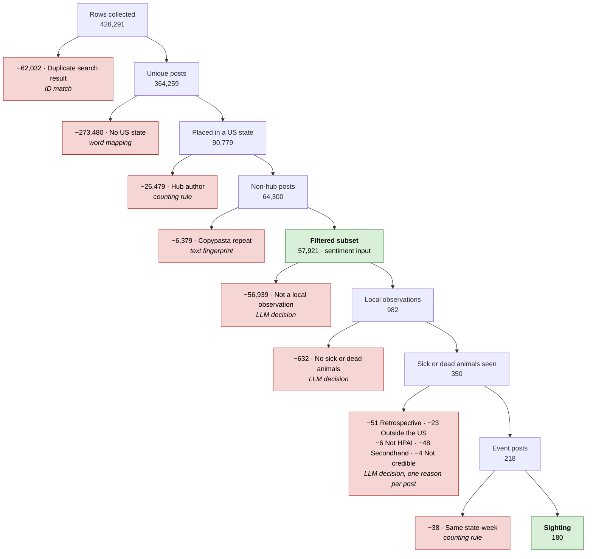

# X data funnel: from every collected post to a handful of sightings

*Nick, 2026-10-19. Counts are rows of `x_post` in Cloud SQL. Every row, with its disposition,
is in the table `x_post_analysis` (built by `h5n1/sources/x_analysis_table.py`).*

We collected 603,265 rows of X posts that mention bird flu. Of those, **243 survive as
sightings**: a post where someone in a US state says they saw sick or dead animals
recently. This document follows the rows through every cut. Each step removes rows for
**one reason only**, and says **which technique** made the call.

Each step's name, in bold below, is the exact value of `disposition` in `x_post_analysis`.
A row's disposition is the first step that removes it; a row that survives every step is a
**Sighting**. `disposition_step` holds the step number (16 for Sighting).

## The four streams

The posts come from two collectors. They're processed as four separate streams, because the
rules differ slightly by language and the English source changes on 2025-01-01.

| Stream | Source (`corpus`) | Language | Dates kept | Folder |
|---|---|---|---|---|
| **prior** | the previous cohort's scraper (`prev_cohort_en`) | English | 2022-06..2024-12 | `data/X_derived/` |
| **en_test** | twitterapi.io (`twitterapi_en`) | English | 2025-01 on | `data/X_derived/test_2025/` |
| **es** | twitterapi.io (`twitterapi_es`) | Spanish | 2022-06 on | `data/X_derived/es/` |
| **fr** | twitterapi.io (`twitterapi_fr`) | French | 2022-06 on | `data/X_derived/fr/` |

## The techniques

Every step uses one of these. Only the last one involves a model making a judgement.

| Technique | What it means here | Reproducible? |
|---|---|---|
| **ID match** | Two rows share a post ID. | Exactly |
| **Metadata rule** | A field X supplies: the post date or the post type. | Exactly |
| **Word mapping** | The profile location is matched against Census place, county and ZIP tables with fixed rules (`h5n1/sources/x_location.py`). No model. | Exactly |
| **Word list** | A fixed list of place names; any profile containing one is dropped. The list was written by reading the data. | Exactly, once written |
| **Counting rule** | A threshold on how many posts an author or a state-week has. | Exactly |
| **Text fingerprint** | Posts whose cleaned first 80 characters are identical. | Exactly |
| **LLM decision** | Claude subagents read each post and answer written yes/no questions. | Judgement; spot-checked |

## At a glance (prior stream)

The prior stream is the largest, so it's drawn here. The table after it gives all four streams.

Steps 2, 3 and 5 remove nothing in the prior stream, so they aren't drawn.

## All four streams

Rows in **bold** are what remains; the other rows are the rows removed at that step. A dash
means the step doesn't apply to that stream.

| # | Disposition | What it means | Technique | prior | en_test | es | fr |
|---|---|---|---|---:|---:|---:|---:|
| | **Rows collected** | | | **426,291** | **78,591** | **76,631** | **21,752** |
| 1 | Duplicate search result | Same post returned by more than one search | ID match | 62,032 | 0 | 0 | 969 |
| 2 | Outside date window | Posted outside the stream's dates | Metadata rule | 0 | 15,386 | 7,031 | 3,836 |
| 3 | Quote post | A quote of another post | Metadata rule | 0 | 5,153 | 4,245 | 1,761 |
| | **Posts in the stream** | | | **364,259** | **58,052** | **65,355** | **15,186** |
| 4 | No US state | Profile location doesn't resolve to one US state | Word mapping | 273,480 | 44,963 | 64,145 | 15,011 |
| 5 | Foreign place name | Profile names a place outside the US in the stream's language area | Word list | — | — | 360 | 34 |
| | **Placed in a US state** | | | **90,779** | **13,089** | **850** | **141** |
| 6 | Hub author | Top 1% by volume, not farm or ag | Counting rule | 26,479 | 4,610 | 67 | 0 |
| 7 | Copypasta repeat | Later copy of a mass-posted text | Text fingerprint | 6,379 | 351 | 19 | 1 |
| | **Filtered subset** (`use_sentiment`) | | | **57,921** | **8,128** | **764** | **140** |
| 8 | Not a local observation | Not firsthand or near-firsthand | LLM decision | 56,939 | 7,957 | 762 | 139 |
| | **Local observations** | | | **982** | **171** | **2** | **1** |
| 9 | No sick or dead animals | Local, but no illness seen | LLM decision | 632 | 86 | 1 | 1 |
| | **Sick or dead animals seen** | | | **350** | **85** | **1** | **0** |
| 10 | Retrospective | Event more than ~30 days before the post | LLM decision | 51 | 8 | 0 | — |
| 11 | Outside the US | Event is outside the US | LLM decision | 23 | 2 | 0 | — |
| 12 | Not HPAI | Tested negative, or another disease | LLM decision | 6 | 0 | 0 | — |
| 13 | Secondhand | Relayed from outside the author's state | LLM decision | 48 | 1 | 0 | — |
| 14 | Not credible | Joke, sarcasm or conspiracy | LLM decision | 4 | 1 | 0 | — |
| | **Event posts** | | | **218** | **73** | **1** | **0** |
| 15 | Same state-week | Same state and week as an earlier sighting | Counting rule | 38 | 11 | 0 | — |
| | **Sighting** (`use_sightings`) | | | **180** | **62** | **1** | **0** |

In total: **243 sightings from 603,265 rows collected**, about 1 in 2,500.

## Step by step

Post text in the examples is quoted with handles replaced by `@user` and links by `[link]`,
and is shortened.

### 1. Duplicate search result · *ID match*

Each search term was run separately, so a post mentioning both "H5N1" and "HPAI" came back
once per term. Within each collector, rows with the same post ID are collapsed to one, and
every term that found the post is listed in `search_terms`.

More detail and examples

- **Which row is kept:** the row whose search term sorts first alphabetically. When the rows
  share even their search term (969 French rows; some carry follower counts from a later
  fetch), they're numbered by `row_seq` in a fixed order (an md5 hash of the raw record) and
  row 1 is kept. The kept row is the only one that moves on to step 2.
- The prior cohort ran one search per term and exported one CSV per term, so overlap is large:
  426,291 rows hold 364,259 distinct posts. In 973 of those posts the copies differ slightly
  (like counts captured at different times). The kept row is the one the pipeline used.
- Nothing about the post is judged; it's a straight ID match.

Examples (terms that found it → post):
- `Avian influenza | H5N1 | HPAI` → "Five H5N1 HPAI Green Winged Teals Greene County Indiana -
  Recombinomics Inc. map update…"
- `H5N1 | H7N9 | HPAI` → "The Spanish Flu was H1N1 not H7N9 … HPAI typically refers to H7N9 and
  H5N1 strains."

### 2. Outside date window · *Metadata rule*

Each stream keeps only its own dates. For en_test that means 2025 on. Before 2025 the English
posts come from the prior cohort's scraper, and mixing the two collectors would blur the
comparison.

More detail and examples

- **en_test** drops all twitterapi.io English before 2025-01-01. That collector has no English
  for 2022-06..2024-12, only a stray 2021-09..2022-05 window, so the 15,386 removed are all
  from that early window.
- **es** and **fr** drop posts before 2022-06-01, the start of the study period.
- **prior** loses nothing: the scraper only covered 2022-06..2024-12.

Examples (removed from en_test):
- 2022-03-02: "BREAKING: Iowa confirms a positive case of highly pathogenic avian influenza
  (HPAI) in a backyard poultry flock."
- 2022-05-21: "'Heartbreaking' loss as avian influenza hits backyard chicken flocks in Alberta"

### 3. Quote post · *Metadata rule*

A quote post is someone's comment on top of another person's post. The prior cohort's scraper
didn't collect them, so they're dropped from the other streams too, to keep the streams
comparable.

More detail and examples

- X labels every post as original, reply or quote; only quotes are dropped. Replies stay,
  because the prior cohort did collect them.
- The quoted post's text isn't in the row, so a quote is often hard to read on its own anyway.

Examples (removed from en_test):
- 2025-01-01: "How can doctors be so stupid? #H5N1 #maskup"
- 2026-05-17: "$3K to $24K so far from here. $H5N1 study."

### 4. No US state · *Word mapping*

X doesn't geotag these posts. The only geography is the free-text location the author typed
into their profile. If that text can't be matched to a single US state, the post is dropped.
This is the largest cut in every stream.

More detail and examples

The geocoder (`h5n1/sources/x_location.py`) is a fixed set of rules over 2021 Census tables;
no model is involved. It tries, most specific first:

1. A 5-digit ZIP, mapped to the county holding most of its land.
2. A nickname from a short alias list (NYC, Philly, DMV, Bay Area).
3. "X County, ST".
4. "City, ST", using Census places and towns. A county is assigned only if at least 80% of
   the city's land is in one county.
5. A big city named with no state, accepted only if it's over 100,000 people and at least 5
   times bigger than any other place with that name. Paris, Springfield and Columbia are
   never accepted.
6. A state name, or a two-letter code written in capitals ("in", "me" and "or" are words).

French profiles are first put into English for US place names ("Louisiane" → "Louisiana").
In `x_post_analysis` the result is in `geo_level` (which rule matched, or why none did),
`state` and `county_fips`, filled for every row.

A hand check of 45 strings found it about 95% right. Results on the prior stream:

| Why it failed (`geo_level`) | Posts | Examples |
|---|---:|---|
| Blank or not a place (`none`) | 191,545 | "Global", "Zombie planet." |
| Outside the US (`foreign`) | 66,236 | "Vancouver, British Columbia", "Scotland" |
| Only "USA" (`us`) | 14,413 | "United States", "Rural America" |
| More than one state (`multi`) | 1,286 | "Toledo, OH & Louisville, KY", "DC, NYC, ATL, STL, TEX & CA" |

Successes look like "Camp Hill, PA" → PA (county 42041) and "Florida, USA" → FL. Note that
this is where the author says they live, not where the post is about.

### 5. Foreign place name · *Word list*

Spanish and French profiles often name a city that also exists in the US, or a postcode that
looks like a US ZIP. Any profile that names another Spanish- or French-speaking country or
region is dropped, even if step 4 placed it in a state.

More detail and examples

- The lists (`ES_FOREIGN` and `FR_FOREIGN` in `h5n1/sources/x_posts.py`) are fixed word
  lists. **They were written by reading every location the geocoder had placed in a state and
  adding the misreads**, so the list itself is a reading judgement, even though applying it is
  mechanical. No second reader has checked it.
- These rows keep the geocoder's `geo_level`, but `state` and `county_fips` are blank.
- English streams don't use this step.

Examples (step 4's wrong reading → dropped):
- "Bogotá, D.C., Colombia" → read as DC
- "Tijuana, Baja California" → read as California
- "Maine-et-Loire" (a French département) → read as Maine
- "ETATS DE CHOC PREMIERE PARTIE" → read as Delaware, from the capital letters "DE"

### 6. Hub author · *Counting rule*

A hub is an author in the top 1% by post count who isn't a farmer or an agricultural
institution. These are mostly news relays and outbreak trackers. They post about every state,
so their posts carry no local signal. All their posts are dropped.

More detail and examples

- Volume is counted before 2025 for prior, es and fr. For en_test it's counted on 2025+, and
  anyone who was a hub in the prior stream stays a hub.
- The farm and ag exemption depends on the author's **account type** (`account_type`), and
  for some authors that is an **LLM decision**. Claude subagents labelled every top-1% author,
  and every author whose bio has a farm word, as farmer, ag institution, media or general
  public (`account_type_source` = `llm_bio`), following the written guide in Appendix A below. Everyone else was labelled by a simple word rule:
  news words in the bio mean media, otherwise general public (`regex`).
- `hub_author` is the flag.

Examples (prior stream):
- FluTrackers.com, a volunteer outbreak-tracking site: 2,973 posts, labelled media.
- A scientist who tracks H5N1 and relays every report: 7,121 posts, labelled media.
- A general-public account posting 7,337 times. It's still a hub, because the rule is about
  volume, not type.

### 7. Copypasta repeat · *Text fingerprint*

When many accounts post the same text, it's a campaign, a shared headline or a bot, not
independent local voices. The first copy is kept and the repeats are dropped.

More detail and examples

- Each post's text is lowercased, and links, handles, numbers and punctuation are removed. The
  first 80 characters become its fingerprint.
- A fingerprint shared by at least 5 posts from at least 2 authors is copypasta (`copypasta`).
  Groups are formed over all of a stream's posts, located or not.
- **Which post is kept** (`copypasta_first`): the earliest, with ties at the same second broken
  by the smallest post ID. If the kept copy was already dropped at step 4 or 6, every located
  copy is dropped here.

Examples (largest groups, prior stream):
- "Russia claims they collected evidence of avian flu pathogens…": 424 posts
- "Demand mandatory nationwide bulk milk tank testing of the raw…": 189 posts
- "No animal deserves to be broiled alive. And yet millions of…": 161 posts

**What's left here is the filtered subset**: 57,921 / 8,128 / 764 / 140 posts, flagged
`use_sentiment`. This is the input for **sentiment**. Each post's score is Waree's XLM-R
sentiment model (`x_post_sentiment`), carried into the table as `negative_score`,
`neutral_score`, `positive_score` and `sentiment` (positive minus negative), and averaged per
state over a trailing 7 days. Every row in the filtered subset has a score. Sentiment removes
nothing; the steps below are only for finding sightings.

### 8. Not a local observation · *LLM decision*

A reader answers one question for every post in the filtered subset: did the author, or
someone close to them, see or experience this? News, announcements, statistics, opinions,
fear and jokes are all "no". This step turns tens of thousands of posts into about a thousand.

More detail and examples

- Claude subagents (Sonnet) read every post in 500-post batches and answered questions 1 and 2
  of the written guide (Appendix B below) in one pass. The answers are `local_obs` and
  `illness_seen`; the working files are `labels/full_review/labels_*.csv` in each stream's
  folder, made and merged with `h5n1/sources/x_topics.py`.
- **Yes** includes sick or dead wild birds the author saw, their own flock affected, tested or
  kept indoors, a neighbour's farm quarantined, or a local closure they witnessed.
- **Local news can count.** The guide counts "their town's park", so the reader treats a local
  news headline about dead birds at a named park as a local observation. An independent second
  reading of one en_test batch agreed on 20 of its 21 sick-or-dead posts, so this is the guide
  working as written, not reader noise. Step 13 removes such posts only when the news is from
  outside the author's state.

Examples (answered "no"):
- "With the recent HPAI cases in TX wild and domestic birds it is imperative to protect your
  poultry by practicing strong biosecurity…" (advice, not an observation)
- "@user Yeah. Y'all killed all the chickens because 'avian flu' 😂" (opinion and joke)
- "Gripe aviar en California: Decretan estado de emergencia" (news)

### 9. No sick or dead animals · *LLM decision*

The second question is stricter: does the post describe sick animals, dead animals, or an
infection among animals the author saw or owns? Precautions alone don't count.

More detail and examples

- The same reader answered question 2 in the same pass. A "no" here means a real local
  observation that isn't a sighting of illness: birds kept inside, a closed aviary, a negative
  test.

Examples (local, but answered "no"):
- "The aviary was closed because of avian flu but I caught a peek at the baby shorebird floating
  around with parents…" (CA, a closure the author saw)
- "We are now accepting ALL bird species! … As avian influenza cases have dropped we still
  quarantine birds with strict biosecurity." (VA, a rehab centre's policy)
- "…chez moi les Loiseau dont confinés pour ne pas disseminer leurs miasmes." (FL, birds kept
  indoors; the only French local observation; spelling as posted)

### 10–14. The exclusion screen · *LLM decision*

Each remaining sighting is read once more, against five written exclusion reasons. **Each
post gets at most one reason**, so each reason is its own step in the table. The reader sees
only the text, the author's state and the date, never the outbreak data.

More detail and examples

The guide is Appendix C below. The reason is in
`exclusion_reason` (blank for kept posts); the working files are
`labels/full_review/excl_labels_*.csv` in each stream's folder. One reader read all of a
stream's posts, so each rule is applied the same way throughout.

If the text names a different US state from the author's profile, the reader moves the event
to that state (`event_state`; 15 prior posts, 3 en_test). That is the only point where an LLM
changes a location.

**What this screen does not remove:** Secondhand means relayed *from outside the author's
state*. A local news headline from the author's own state, such as "Dead geese found in pond
at Mount Pleasant park test positive for bird flu", is kept and counts as a sighting.

**10. Retrospective**, the event was more than about 30 days before the post:
- "In August while visiting the Patuxent Refuge i found a heron prostrate on a bank…" (posted
  in November)
- "The last time the avian flu came through the big farms got completely wiped out and I lost
  only 1 out of 12."

**11. Outside the US:**
- "Perfect weather for an afternoon at Minsmere… Sad to see so many dead birds. Victims of
  avian flu I assume." (Minsmere is in England; the author's profile says Virginia)
- "The beaches south of Lima were absolutely littered with dead birds when I was there…"
  (author in Kansas)

**12. Not HPAI:**
- "Its not h5n1 but we do have a bird flu killing chickens here in southern MI."
- "However both WNV & HPAI tests came back negative & within a week this bird was much
  improved with supportive care." (VA)

**13. Secondhand:**
- "Veterinary daughter in SW US knew of 5 local cats that died of #BirdFlu…" (author in Iowa)
- "So sad to share the news that Emmanuel Todd Lopez's farm was hit with Avian Flu and over 90%
  of the birds have died…" (author in California; the emu's farm is in New York)

**14. Not credible:**
- "Prolly same reason dead dove on the drive way I want to get tested for avian flu but
  prolly just psyops trying freak me out" (AZ)
- "The amish in my area said they have been forcing them to vaccinate their cattle… Now they
  are dying."

**Kept**, for comparison:
- "A friend of mine owns a bunch of chickens. Avian flu got them and he had to slaughter all of
  them." (IL)
- "Two weeks ago, we lost 5 wild Muscovy ducks who hung out in our front yard to avian flu…"
  (FL)
- "Gripe aviar? Por aquí (New York) hay mucha muerte de aves acuáticas y de águilas calvas."
  (NY, the only Spanish sighting)

### 15. Same state-week · *Counting rule*

One die-off can be posted about several times. The analysis counts one sighting per state per
week, keeping the earliest post.

More detail and examples

- Weeks are calendar weeks, Monday to Sunday, in UTC; `sighting_week` is the Monday. The state
  is `event_state`.
- **Which post is kept:** the earliest, with ties broken by the smallest post ID. Applied within
  each stream.
- 38 prior posts and 11 en_test posts shared a state-week with an earlier one.

Example (AZ, both posted 2023-11-04, the second dropped):
- "Reid Park Zoo has received positive avian influenza test results for three of the birds in
  its care…"
- "'Our animal care and veterinary team was able to enact safety measures as soon as avian flu
  was suspected to keep the other birds in our care safe…'"

**What's left is the Sighting rows**: 180 / 62 / 1 / 0, flagged `use_sightings`.

## The `x_post_analysis` table

One row per `x_post` row: 603,265 rows, keyed by `(corpus, post_id, source_query, row_seq)`.
It holds everything the X analysis needs, so nothing else X-related has to be joined:

- **The post:** `stream`, `search_terms`, `created_at`, `post_type`, `lang`, `post_text`, `url`,
  the author's `user_id`, `user_name`, `alias` and `user_location`, and the engagement counts.
- **Location:** `geo_level`, `state`, `county_fips` (steps 4–5).
- **Author:** `account_type`, `account_type_source`, `hub_author` (step 6).
- **Copypasta:** `copypasta`, `copypasta_first` (step 7).
- **Sentiment:** `negative_score`, `neutral_score`, `positive_score`, `sentiment`.
- **Labels:** `local_obs`, `illness_seen`, `exclusion_reason`, `event_state`, `sighting_week`.
  These are blank for rows that never reached the step.
- **Outcome:** `disposition_step`, `disposition`, `use_sentiment`, `use_sightings`.

Sentiment input is `WHERE use_sentiment`; sightings are `WHERE use_sightings`. To rebuild:
`uv run python -m h5n1.sources.x_analysis_table build`, then `load`.

**The table is the record of the LLM labels.** A second reading would not give exactly the
same answers, so `build` reads `local_obs`, `illness_seen`, `exclusion_reason` and
`event_state` back from the table rather than from local files. A rebuild needs only the
database, the raw prior-stream CSVs in `gs://h5n1-raw/X/`, and each stream's `x_posts`
outputs. New readings of posts the table doesn't have yet go in `labels_extra*.csv` and
`excl_labels_extra*.csv` in the stream's `labels/full_review/` folder.

## What this means

- **Location is the biggest cut and the hardest limit.** Three-quarters of English posts, and
  almost all Spanish and French ones, have no usable US location. That's a property of X
  profiles, not of our filters.
- **Firsthand sightings are rare.** About 2% of the filtered English posts are local
  observations, and about a third of those mention sick or dead animals.
- **Spanish and French add almost nothing:** one sighting between them, from New York in 2023.
- **Local news headlines count as sightings** when they come from the author's own state. That
  follows the written guides, but it is a design choice the team should confirm.
- **Where judgement enters:** steps 8–14 are LLM decisions, the step 6 exemption uses LLM
  account types, and the step 5 word lists were written by reading the data. Every other step
  is a fixed rule that gives the same answer every time.

## Appendix A — account types (step 6)

One label per author, from the bio and display name:
- `farmer_keeper`: a person or family operation that actually raises animals or crops.
  - Includes farmers, ranchers, dairy/poultry/egg/turkey/hog growers, homesteaders,
    backyard chicken or duck keepers, a farm spouse or kid describing their own farm, and
    4-H/FFA youth.
  - Excludes people who merely like farms or food, chefs, crypto "yield farming", "Ranch"
    as a place name, and "beef" as slang.
- `ag_institution`: organizations or professionals serving agriculture or animal health.
  - Extension, state or federal ag departments, USDA/APHIS, state veterinarians,
    individual veterinarians, ag colleges and scientists, farm bureaus, commodity boards
    and producer associations, agribusiness companies, ag lenders, insurers and
    consultants.
- `media_aggregator`: news outlets, journalists, reporters, editors, TV/radio producers,
  anchors, ag media, outbreak trackers, alert accounts and bots, newsletters, and bloggers
  or podcasters whose account mainly relays news.
- `general_public`: everyone else. This includes scientists and clinicians outside
  agriculture, activists, politicians, and incidental ag words.

Precedence rules:
- An author who clearly farms is `farmer_keeper`.
- An ag journalist is `media_aggregator`.
- An ag vet is `ag_institution`.
- An empty bio is judged by display name, else `general_public`.

## Appendix B — local observation (steps 8 and 9)

Two yes/no questions per post. The reader sees only the post text.

1. `local_obs`: is the post mainly a firsthand or near-firsthand local observation?
   - **Yes** if the author, or someone near them, saw or experienced it: family, a neighbor,
     their farm, their town's park, their organization's own animals.
   - That includes sick or dead wild birds or animals, sick or dying poultry or livestock,
     their own flock or herd affected, tested or kept indoors, a neighbor's farm quarantined,
     or a local closure they witnessed.
   - **No** if the post relays an announcement, news, a case count, statistics, a policy
     opinion, general fear or a joke.
2. `illness_seen`: stricter.
   - **Yes** only if it describes sick animals, dead animals, or a suspected or confirmed
     infection among animals the author or their circle directly observed or owns.
   - Precautions alone are **no**: birds kept inside, an aviary closed, a negative test.
   - `illness_seen` implies `local_obs`.

## Appendix C — exclusion screen (steps 10–14)

For each `illness_seen` post. The reader sees the text, the author's profile state and the
post date. Exclude a post, recording the reason, if it is:
- `outside_us`: the described event is outside the US, whatever the author's profile says.
- `retrospective`: the event happened more than about 30 days before the post, or it is a
  general career or past-experience anecdote.
- `not_hpai`: the author says it tested negative or is another disease.
- `secondhand`: a report relayed from outside the author's state, with no local link.
- `not_credible`: a joke, sarcasm, or a conspiracy claim presented as an observation.

If the text names a different US state than the author's profile, the event is assigned to
the named state.
