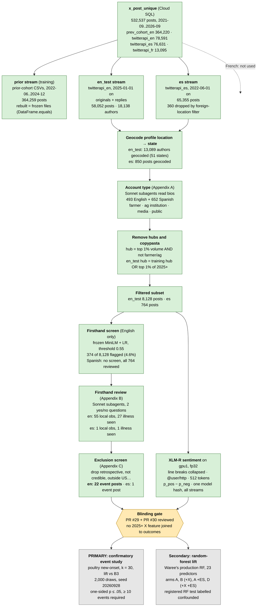

# X pipeline walkthrough: raw posts to the confirmatory event study

*Nick, 2026-10-16. For a review with Waree and Max. Backing documents: PR #29 (Amendment 1 to
`docs/x_event_preregistration.md`) and PR #30 (the pipeline code).*

## The question

Do firsthand X reports of sick or dead animals arrive **before** USDA/APHIS confirms H5N1 in a
state's poultry? The primary test (Amendment 1, item 2) is an event study. Each screened
firsthand post is one event. For each event, we check whether the same state has a **new-onset**
poultry detection in the next 30 days. That rate is compared with a season-matched permutation
baseline (B3). The test was registered before any 2025+ X data was joined to outcomes.

## The pipeline at a glance

Green steps are done, amber steps are waiting on you, and grey steps are next. The counts shown
are for the test period (2025-01-01 on). The training-period (2022-06..2024-12) inputs are
the frozen exploratory files, reused unchanged.

## What I've done, step by step

1. **Found out what the data is.** `x_post_unique` is stitched from two collections.
   - The prior cohort's scraper covers English 2022-06..2024-12.
   - twitterapi.io covers English only outside that window (2021-09..2022-05 and 2025-01 on),
     plus Spanish and French for the whole period.
   - So the English source **switches on 2025-01-01, the exact train/test split**. Any change
     in X features at the split is partly a change of collector. That is why Amendment 1 makes
     the within-state event study primary and labels the registered RF test confounded.
   - Muthu's "X_Expanded" drop turned out to be a Meta Facebook export with no geography, and
     it's not used.
2. **Amended the pre-registration (PR #29), not deleted it.** Blinding was still intact, so an
   amendment is legitimate. Deleting it would look like burying a registered test. The
   amendment covers:
   - the corpus;
   - the sentiment model, which is now Waree's XLM-R;
   - the event study promoted to primary;
   - Spanish as a secondary nested arm;
   - all model inference on gpu1;
   - a forking-paths statement (the promoted design is the one that looked best in
     exploration).
3. **Built the code (PR #30).** One pipeline with three streams: prior, en_test and es.
   - Rebuilding the prior stream reproduces the frozen training files exactly, so the training
     inputs listed by hash in the amendment are unchanged.
   - The English screen is frozen. It uses the stored gold embeddings and the prior threshold,
     and nothing is refit on 2025+ posts.
4. **Ran every step up to the blinding gate:** bio labels, subset, sentiment, screen, review and
   exclusions.
   - All labelling was done by in-session Sonnet subagents. No paid LLM API was used.
   - I spot-checked the borderline calls.
   - Nothing has been joined to outbreak outcomes.

## What I need from you

| # | Ask | Who |
|---|-----|-----|
| 1 | Review **PR #29** (the amendment). Is the confirmatory design sound, and is anything missing? | Both |
| 2 | Review **PR #30** (the code). Does it do what #29 says? | Both |
| 3 | **Confirm the blinding.** Has anyone joined 2025+ X data (including `x_post_sentiment`) to USDA outbreaks, by state or date, in any notebook or chart? If yes, it has to be disclosed in the amendment before the confirmatory run. | Both, especially Waree |
| 4 | **How `x_post_unique` was loaded.** The loader isn't in the repo, and the twitterapi query strings (`phrases` / `subtypes`) aren't recorded. Who ran it, and where is the query list? | Whoever knows (Muthu?) |
| 5 | **One judgement call, decided before outcomes.** An Ohio author describes two eaglets dying at a Florida eagle nest (likely a nest camera). It's currently kept as a Florida event. Keep it, or exclude it as `secondhand`? | Both |

## What's next

1. Address the review comments on #29 and #30, then merge them, #29 first.
2. **Run the confirmatory event study** (the primary test):

       DB_PORT=5433 uv run python -m h5n1.models.x_event_study events --start 2025-01-01 \
           --end <last poultry date - 30> \
           --events data/X_derived/test_2025/labels/illness_posts_screened.parquet --tag en_test

   - The pass rule is a one-sided permutation p ≤ .05, with at least 10 new-onset events.
   - **We have 22 event posts.** After de-duplicating to one per state per week and keeping
     only new-onset, I expect about 10, right at the floor, so the test is underpowered. A null
     will not be strong evidence of no effect.
3. **Run the secondary RF lifts:** English, the within-period z-scored version, and Spanish (arms
   A +ES and D +X +ES, 95% CIs, no claims).
4. Write up the results against the amendment, including the confounded registered RF test and
   the forking-paths caveat.

## Caveats to say out loud

- **Spanish adds almost nothing measurable.** Only 850 Spanish posts geocode to a US state,
  and one survives as an event. The Spanish event study won't run; the forest arms will, as a
  documented null.
- **Hubs are large in 2025+.** 648 hub authors wrote 47% of English posts; they're removed by
  rule.
- **Few farmers.** The English 2025+ subset has 154 farmer posts, so the firsthand signal comes
  mostly from the general public.
- **The screen's recall is about 0.81** (from the training-period cross-validation), so about
  19% of true firsthand posts are knowingly left unreviewed. That's the same rule as in
  training.
- **Compute.** MiniLM ran on CUDA, while the gold embeddings were made on CPU (max difference
  8e-8). That can only matter for a post sitting exactly at the 0.55 threshold.
