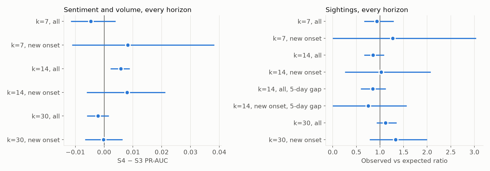
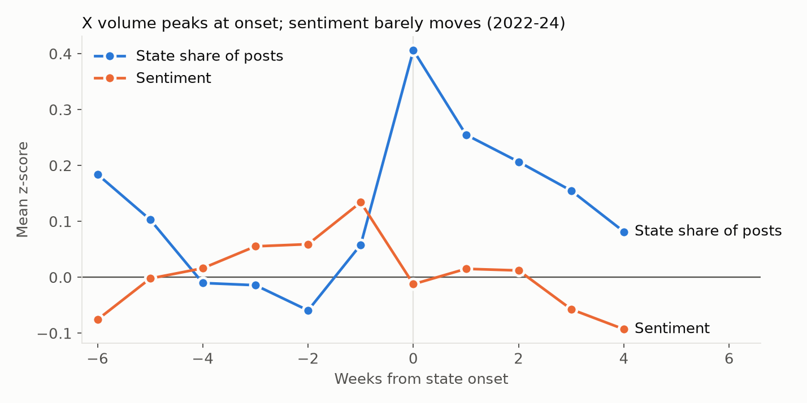

# What is the X data worth? Results of the 2025+ test

*2026-10-31. Design frozen in `docs/x_utility_spec.md`, commit `4ec0b2a`, before any X data was scored
against a 2025+ outcome.*

This analysis asks whether posts on X help predict USDA-confirmed H5N1 poultry outbreaks beyond what
surveillance data already shows. It works at state level, because too few posts can be placed in a
county. For each state and week, a model forecasts whether the state will have an outbreak in the coming
days. We built a state baseline without any X data, added X to it, and measured whether the forecasts
improved. X enters in two ways, tested separately. The **volume and sentiment** of posts are added to
the models as features. **Sightings**, the few posts where someone reports sick or dead animals nearby,
are treated as alerts, and we check whether outbreaks follow them more often than the baseline expects.
Every design choice was made on 2022-24 data and frozen, and then the 2025+ data was scored once.

## The models

### Track A: sentiment and volume

Track A adds the volume and sentiment of X posts to the state models as features, and asks whether the
forecasts improve on state-weeks that have at least one post.

Each row adds to or removes from the others so that the comparison answers a specific question. The
PR-AUC column is from the 2025+ test, forecasting
an outbreak within 14 days (k=14) in states with no outbreak in the prior 30 days (new onset). Higher is
better, and a model with no skill would score the base rate of **0.129**.

| Arm | Contents | Question | PR-AUC |
|---|---|---|---:|
| S0 | Place, season, fixed poultry exposure | What do those alone give? | 0.293 |
| S1 | X only | The X-only model | 0.130 |
| S2 | S0 + X | Does X know anything beyond season and place? | 0.271 |
| S3 | State baseline: S0 plus recent outbreaks, neighboring states, wild birds, migration, weather | Reference | 0.346 |
| S4 | S3 + X | Does X add beyond surveillance data? | 0.354 |
| S4v | S3 + volume only | Does volume contribute? | 0.351 |
| S4s | S3 + sentiment only | Does sentiment contribute? | 0.348 |

*1,043 state-weeks, 135 of them followed by an outbreak. All arms use the same rows.*

All arms use Waree's shallow random forest (300 trees, depth 6, minimum leaf 2) with no tuning.

The baseline is new, because X has no usable county signal: about 1% of county-days have a post. S3
beat the county model rolled up to state level at every horizon in 2022-24, for example PR-AUC 0.263 vs
0.170 on new onsets at k=14, so it stayed as the reference. Those two figures come from the 2022-24
folds and are not comparable with the 2025+ column above.

### Track B: sightings

Track B treats each sighting, a post reporting sick or dead animals nearby, as an alert, and asks
whether outbreaks follow sightings more often than the state baseline S3 already expects; no model is
trained on sightings. Results are from the 2025+ test, forecasting an outbreak within 14 days after any
sighting.

| Comparison | Contents | Question | Result |
|---|---|---|---:|
| Observed vs expected | Outbreaks after sightings against S3's prediction for those weeks, relative to weeks with no sighting | Do sightings add anything beyond the baseline? | O/E ratio 0.85 |
| Season and place | The same state at the same time of year in other years | Are outbreaks more common after a sighting than usual for that state and season? | 35.5% vs 34.5% |
| Which sightings | Post volume, sentiment and S3's risk, fit on the 62 test sightings as description | Do some sightings signal more than others? | Only S3's risk separates them |

*62 sightings, 22 followed by an outbreak against 25.9 expected. An O/E ratio of 1.00 means no added
signal.*

## What we found

X did not clearly help, and neither test met its pre-set rule.

**Track A: sentiment and volume**

- **X alone has no skill.** S1 scored 0.130 against a base rate of 0.129.
- **X adds nothing clear to season and place.** S2 scored below S0, by 0.022, though on this slice the
  interval includes 0 (−0.047 to +0.007).
- **X does not clearly improve the state baseline.** S4 scored 0.008 above S3, with an interval of
  −0.0060 to +0.0212. This was the primary test for volume and sentiment.
- **Timing suggests why.** X volume peaks in the week of a state's first outbreak and fades afterward.
  It behaves like a reaction to outbreaks, not a warning of them.

**Track B: sightings**

- **Sightings do not beat the baseline.** Outbreaks followed 22 of 62 sightings, against 25.9 expected.
  The O/E ratio was 0.85 (0.67 to 1.09), so the primary test was not met, and the data rule out
  sighting weeks running more than about 9% above expected.
- **Sightings tell us no more than season and place.** Outbreaks followed 35.5% of sightings, against
  34.5% for the same state at the same time in other years (p = 0.48).
- **Sightings are too rare to work as alerts.** They appeared on only 3.1% of state-weeks followed by
  an outbreak, so even a perfectly reliable sighting would miss nearly all outbreaks.
- **The earlier promise did not replicate.** The 2022-24 ratio of 1.22 (1.01 to 1.43) fell to 0.85 on
  held-out 2025+ data.

This is a limited claim. The test covers only state-weeks where X has posts, and the training and test
periods come from different collectors. See [Limits](#limits).

## How it was tested

| | Track A: sentiment and volume | Track B: sightings |
|---|---|---|
| **Question** | Does X improve the state baseline? | Given a sighting, is an outbreak more likely than the baseline expects? |
| **Rows** | State-weeks with at least 1 X post | One row per sighting, and the model runs only when one is posted |
| **X input** | State share of national posts; 7-day sentiment; change in sentiment | The sighting itself |
| **Primary measure** | Change in PR-AUC, new onsets, 14 days | Observed vs expected ratio, all sightings, 14 days |
| **Rule to pass** | 95% interval above 0, and still positive with X ending 5 days earlier | 95% interval above 1, and still above 1 with the first 5 days excluded |
| **Test size** | 1,043 rows, 135 positive | 62 sightings |

The tracks are separate because they use different rows and answer different questions, so there is no
single combined X number.

### Terms

- **State-week:** one state in one week ending Sunday. The forecast is made at the end of that Sunday.
- **k:** the forecast horizon. k=14 asks whether an outbreak occurs in the state in the next 14 days.
- **New onset:** a state-week with no confirmed outbreak in that state in the prior 30 days. This is
  where early warning matters most.
- **PR-AUC:** how well a model ranks the rare positive weeks. Accuracy is not used, because a model
  that always says "no outbreak" would look accurate.
- **Observed vs expected (O/E):** outbreaks that followed sightings, divided by the outbreaks the
  baseline predicted for those weeks. The **O/E ratio** divides that by the same figure for weeks with
  no sighting, which cancels any general over or under-prediction by the baseline. A ratio of 1 means
  sightings added nothing.

### How the test was protected

Features, primaries and pass rules were chosen on 2022-24 data only, then committed. The 2025+ window
was scored once, and the scripts refuse to run it again. Training ran through 2024-12-31 minus k.
Testing used state-weeks from 2025-01-05 whose outcome window ended by 2026-07-13, the last loaded
confirmation.

A planted future-outcome column produced very large lift and shuffled X produced about none, so the
pipeline can detect a real signal and does not invent one from noise.

## Track A results: sentiment and volume

**Primary result: +0.0079, 95% CI −0.0060 to +0.0212. Not met.** PR-AUC moved from 0.346 to 0.354 and the
interval includes 0. The largest gain the data allow is about 0.021.

X added nothing clear at any horizon on new onsets, and on its own it barely beat the base rate.

| k | Rows | Base rate | S0 | S1 (X only) | S2 | S3 | S4 |
|---|---|---|---:|---:|---:|---:|---:|
| 7, all | 1,719 | 0.165 | 0.342 | 0.174 | 0.307 | 0.546 | 0.542 |
| 7, new onset | 1,052 | 0.070 | 0.199 | 0.071 | 0.160 | 0.232 | 0.240 |
| 14, all | 1,710 | 0.250 | 0.479 | 0.255 | 0.457 | 0.619 | 0.625 |
| **14, new onset** | **1,043** | **0.129** | **0.293** | **0.130** | **0.271** | **0.346** | **0.354** |
| 30, all | 1,665 | 0.372 | 0.654 | 0.374 | 0.633 | 0.725 | 0.723 |
| 30, new onset | 1,002 | 0.231 | 0.485 | 0.233 | 0.472 | 0.563 | 0.563 |

**S2 is below S0 at every horizon.** Adding X to place and season lowered PR-AUC, significantly on all
rows at every k. That points to the "no detectable signal" reading rather than "real but redundant".

| Secondary check, k=14 | All rows | New onsets |
|---|---|---|
| S4 − S3 | +0.0058 (+0.0022 to +0.0089) | +0.0079 (−0.0060 to +0.0212) |
| Volume only, S4v − S3 | +0.0001 (−0.0033 to +0.0028) | +0.0053 (−0.0100 to +0.0199) |
| Sentiment only, S4s − S3 | +0.0028 (−0.0017 to +0.0066) | +0.0017 (−0.0099 to +0.0150) |
| X ending 5 days earlier | +0.0004 (−0.0028 to +0.0036) | +0.0007 (−0.0120 to +0.0126) |
| Only the part of X the baseline can't explain | +0.0046 (+0.0003 to +0.0080) | +0.0087 (−0.0043 to +0.0235) |
| Block permutation p | 0.18 | 0.39 |
| X's unique share of explained deviance | 0.00% | 0.06% |

**One result needs care.** On all rows at k=14, S4 beat S3 and the interval excludes 0. It is a
secondary result with no multiplicity correction, the gain is about 0.6 points of PR-AUC, the permutation
test does not support it, and it nearly disappears with X ending 5 days earlier. State announcements
often come before the APHIS confirmation date, so X may simply be reacting to news of an outbreak
already known locally. It is not evidence of early warning.

**Sentiment was not significant at k=14**, with p = 0.42 to 0.65 for the sentiment level given the
baseline. Of 18 single-term tests across the horizons, one was below 0.05 (sentiment change, k=30, all
rows, p = 0.042), and about one would be expected by chance.

## Track B results: sightings

**Primary result: O/E ratio 0.85, 95% CI 0.67 to 1.09. Not met.** Outbreaks followed 22 of 62 sightings
against 25.9 expected, and the data rule out sighting weeks running more than about 9% above expected.

| Test | Sightings | Followed | Rate | Expected | O/E ratio | 95% CI |
|---|---:|---:|---:|---:|---:|---|
| k=7, all | 62 | 18 | 29% | 18.5 | 0.93 | 0.66 to 1.29 |
| **k=14, all** | **62** | **22** | **35%** | **25.9** | **0.85** | **0.67 to 1.09** |
| k=14, first 5 days excluded | 62 | 15 | 24% | 17.3 | 0.85 | 0.59 to 1.12 |
| k=14, 2025-Q1 | 34 | 13 | 38% | 17.1 | 0.70 | 0.53 to 0.91 |
| k=14, later weeks | 28 | 9 | 32% | 8.8 | 1.06 | 0.59 to 1.61 |
| k=14, new onset | 22 | 4 | 18% | 4.0 | 1.02 | 0.26 to 2.08 |
| k=30, all | 62 | 38 | 61% | 33.3 | 1.12 | 0.93 to 1.35 |
| k=30, later weeks | 28 | 16 | 57% | 12.2 | 1.32 | 0.96 to 1.79 |

- **Against season and place alone:** the same state at the same time in other years had an outbreak
  rate of 34.5% at k=14, against 35.5% after a sighting (p = 0.48).
- **As an alert:** sightings appeared on only 3.1% of state-weeks followed by an outbreak at k=14. Even a
  perfectly reliable sighting would miss nearly all outbreaks.
- **Which sightings matter:** post volume and sentiment did not separate better sightings from worse
  ones. Only the baseline's own risk did.
- **New onsets are descriptive only.** There are 22 sightings and 4 outbreaks, too few for a firm claim.
- **Longer horizon:** k=30 leans above 1, and outbreaks after sightings beat the season-matched rate
  (61.3% vs 46.0%, p = 0.002), but the baseline accounts for most of that. It is a secondary result and
  its interval includes 1.

## Why X does not lead

In 2022-24, X volume showed little rise before a state's first outbreak in 30 days. It jumped in the
onset week and faded over the following weeks. Sentiment moved little, with its largest shift about 0.13
standard deviations.

Lead/lag correlations agree: after accounting for recent outbreaks, X volume correlates most strongly
with outbreaks in the same week, at about 0.16.

## Exploration did not replicate

| Primary | 2022-24 folds | 2025+ test |
|---|---:|---:|
| Track A | +0.0049 (−0.0073 to +0.0244) | +0.0079 (−0.0060 to +0.0212) |
| Track B | 1.22 (1.01 to 1.43) | 0.85 (0.67 to 1.09) |

Track B looked promising in 2022-24, with an interval above 1, and that did not hold on held-out data.

## County baseline, for reference

This is Waree's forest on 35 features with no X, trained through 2024, on every CONUS county-day of
2025+. It uses a different grain and base rate, so these numbers are not comparable with the state
tables above.

| k | Slice | Positives | Base rate | PR-AUC | Lift | ROC |
|---|---|---:|---:|---:|---:|---:|
| 7 | All | 4,360 | 0.25% | 0.143 | 56.1× | 0.878 |
| 7 | New onset | 2,973 | 0.18% | 0.016 | 9.0× | 0.834 |
| 14 | All | 7,795 | 0.46% | 0.130 | 28.2× | 0.862 |
| 14 | New onset | 5,797 | 0.35% | 0.027 | 7.7× | 0.828 |
| 30 | All | 14,596 | 0.89% | 0.131 | 14.8× | 0.841 |
| 30 | New onset | 11,758 | 0.73% | 0.046 | 6.3× | 0.816 |

## Limits

- **Collector change.** Features before 2025 come from the previous cohort's scraper, and 2025+ features
  come from twitterapi.io with different search terms. Volume falls about tenfold across the change. The
  final features were chosen to limit the damage, and results by period point the same way, but the
  change can't be fully separated from the result.
- **Partial coverage.** The Track A result applies only where X has posts: 61% of outbreak-followed
  state-weeks at k=14, and 53% for new onsets. Coverage fell from 86% of state-weeks in 2025-Q1 to
  22-46% afterward.
- **Not farmer sentiment.** Farmer and keeper accounts are under 2% of these posts. This test says
  nothing about what farmers themselves are saying.
- **State grain.** X can't be tested at county level with this data, because too few posts geocode to
  a county.
- **Power.** Small effects remain possible. Track A can't exclude a gain of about 0.02 in PR-AUC, and
  new-onset sightings are too few to settle anything.
- **Baseline's small head start.** Wild-bird dates are collection dates, published later, so recent
  detections weren't all known at the forecast date. That favors the baseline over X, though this is
  inherited from the county surface and its size is unmeasured.

**Not tested here:** language differences, emoji effects, and any county-level use of X.

## Reproducing this

| Step | Command |
|---|---|
| State baseline table | `uv run python sql/rebuild_model_county_day.py --variant state_week` |
| County 35-feature table | `uv run python sql/rebuild_model_county_day.py --variant rf35` |
| Coverage report | `uv run --extra modeling python -m h5n1.features.x_state` |
| County baseline | `uv run --extra modeling python -m h5n1.models.x_baselines county` |

Set `DB_PORT=5433` with the Cloud SQL proxy running. Saved results are in `data/X_derived/x_utility/`
as `final_*.csv`, which is gitignored, and `notebooks/x_utility.ipynb` renders them with no fitting.
The `final` commands for each track refuse to run again while those files exist, on purpose: any further
look at 2025+ is exploratory.
